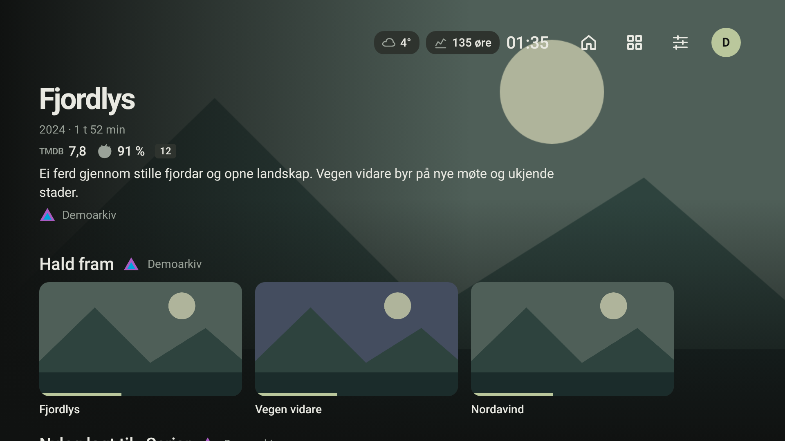
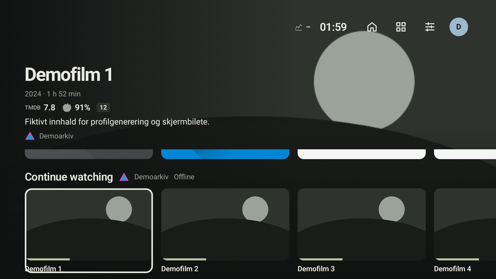
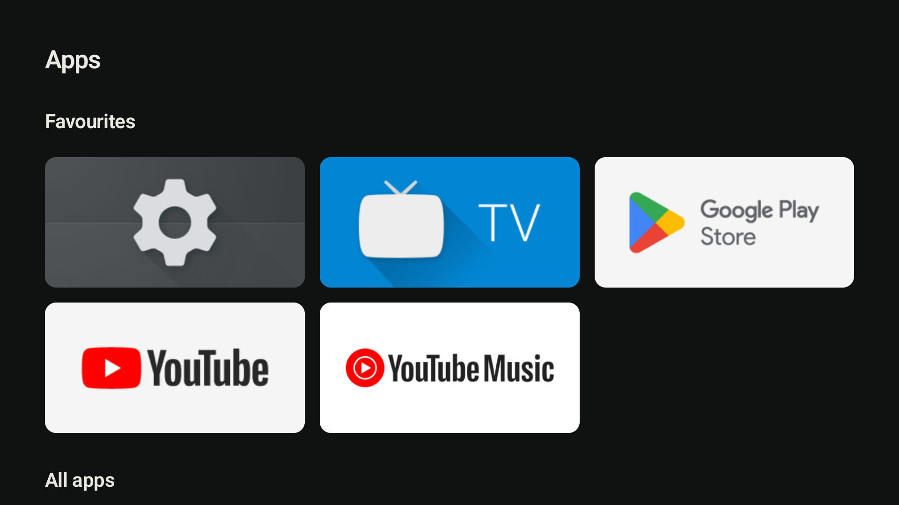
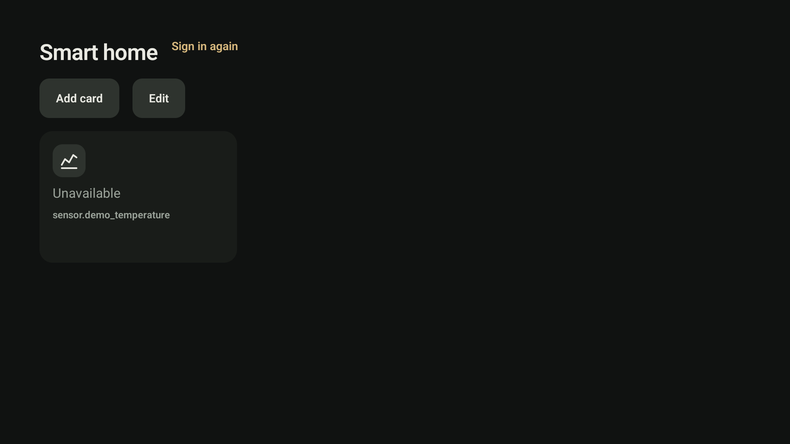

# Stova

Ein flat og rask Android TV-launcher for NVIDIA Shield, med media frå Jellyfin og Emby, eigne profilar og eit lite Home Assistant-dashbord. Fjernkontrollen styrer alt. Spole opnar detaljar og spelar filmar og seriar.



Stova har favorittappar, bufra heimerader, Watch Next, PIN og barnemodus. Home-knappen kan opne Stova medan systemlauncheren framleis er tilgjengeleg.

## Krav og oppsett

- NVIDIA Shield med Android TV 11 / API 30 eller nyare.
- Jellyfin eller Emby for mediarader; Spole med støtte for `spole://open` for avspeling.
- Home Assistant for Smarthus (valfritt).
- Android SDK Platform-Tools på ei datamaskin for installasjon via adb.

Følg [oppsettdokumentet for Shield](docs/SHIELD_SETUP.md). **Ikkje slå av systemlauncheren.** Det finst enno ingen verifisert, signert 1.0-release frå dette arbeidet; Shield-målingar, signering og oppdateringstest står att.

## Skjermbilete

Bileta bruker fiktive data. Emulatorbileta viser lokal demokunst og eit fråkopla smarthuskort, utan personlege kontoar eller tenesteadresser.

| Heim | Appar | Smarthus |
|---|---|---|
|  |  |  |

## Bygg og verifisering

Bruk JDK 17 eller nyare og Android SDK 36. På Windows skal alle Gradle-kall gå via wrapper-skriptet, som set ASCII-stiar for cache og mellombelse filer:

```powershell
pwsh -NoProfile -File scripts/gradle.ps1 testDebugUnitTest lintDebug assembleDebug
pwsh -NoProfile -File scripts/Measure-Stova.ps1 -SelfTest
```

Debug-APK-en ligg i `app/build/outputs/apk/debug/app-debug.apk` og har pakkenamn `app.stova.debug`.

Baseline Profile og kaldstartbenchmark ligg i `baselineprofile/`. Sjå [målerapporten](docs/verification/plan-5-emulator.md) for emulatoroppsett, kommandoar, måltal og avgrensingar. Ytelsesbudsjetta gjeld signert release på Shield: kaldstart ≤ 900 ms, varm Home ≤ 300 ms, hakking ≤ 5 % og PSS ≤ 250 MiB.
