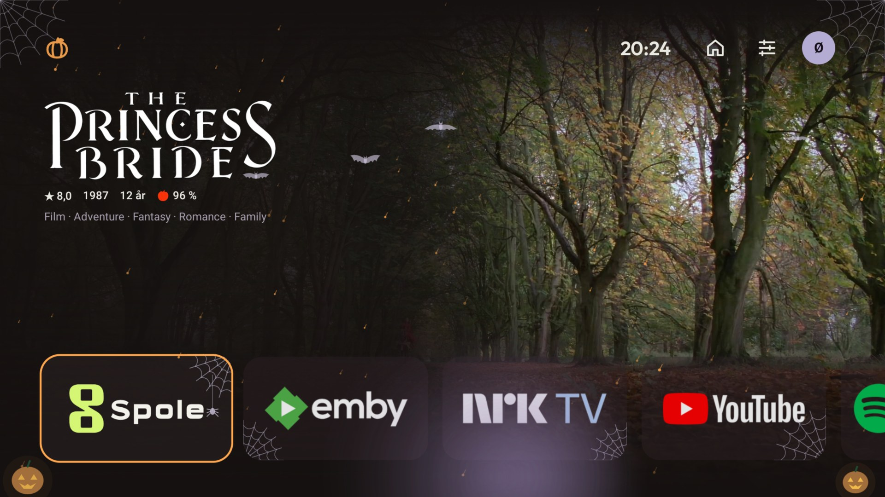
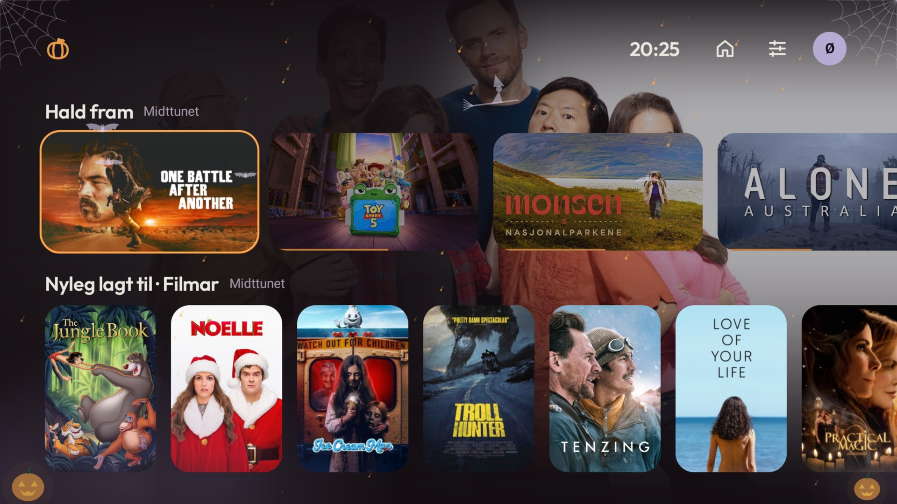
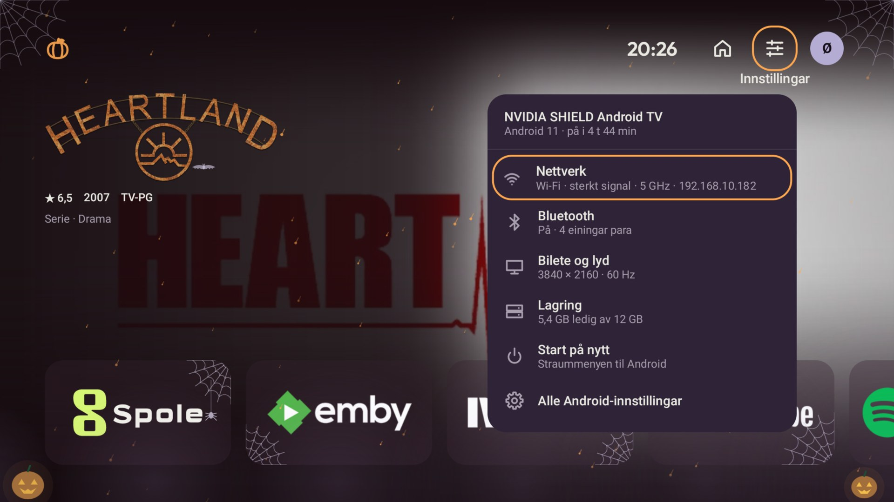
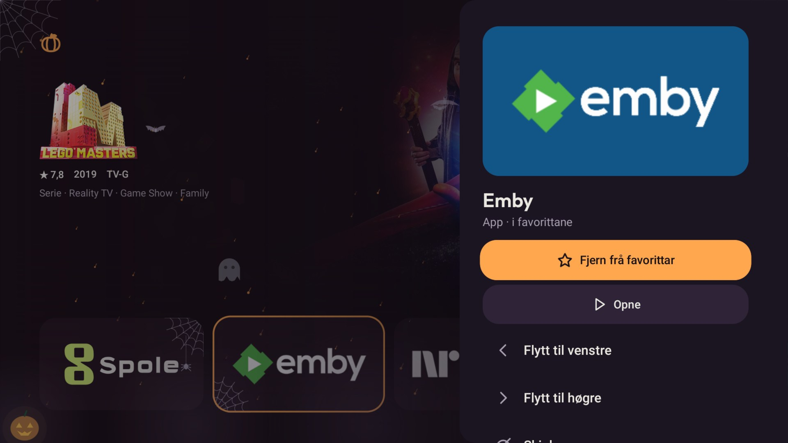
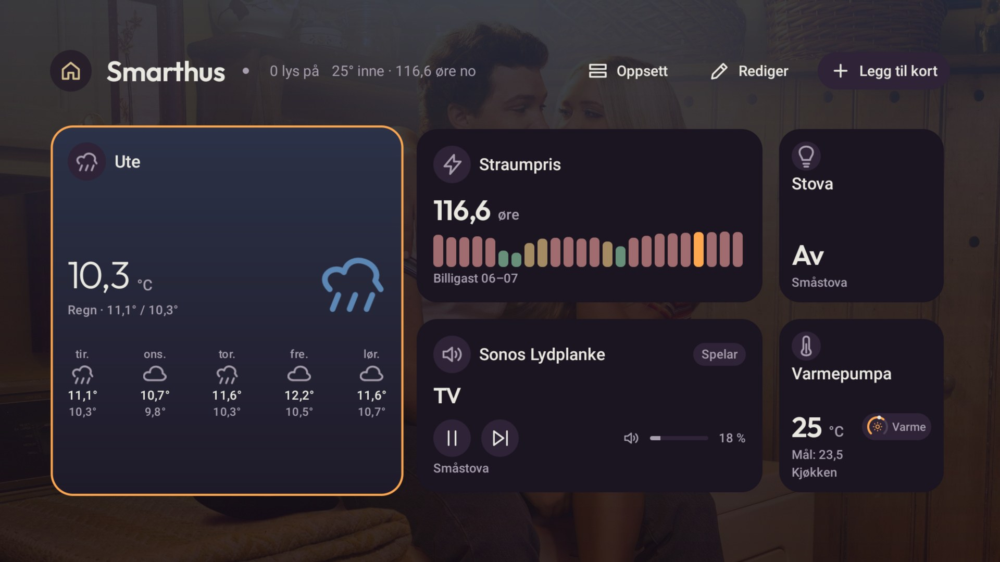
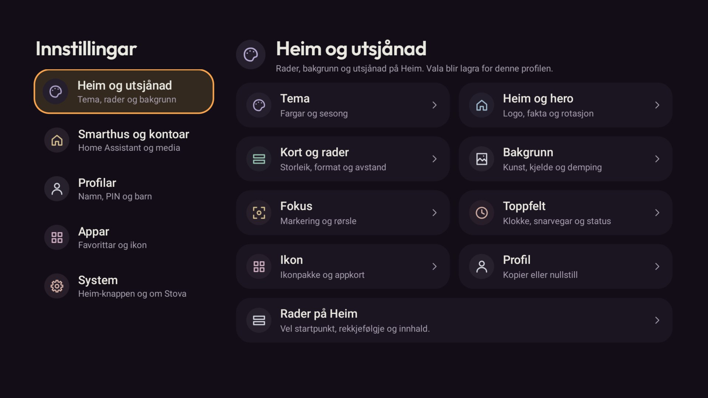
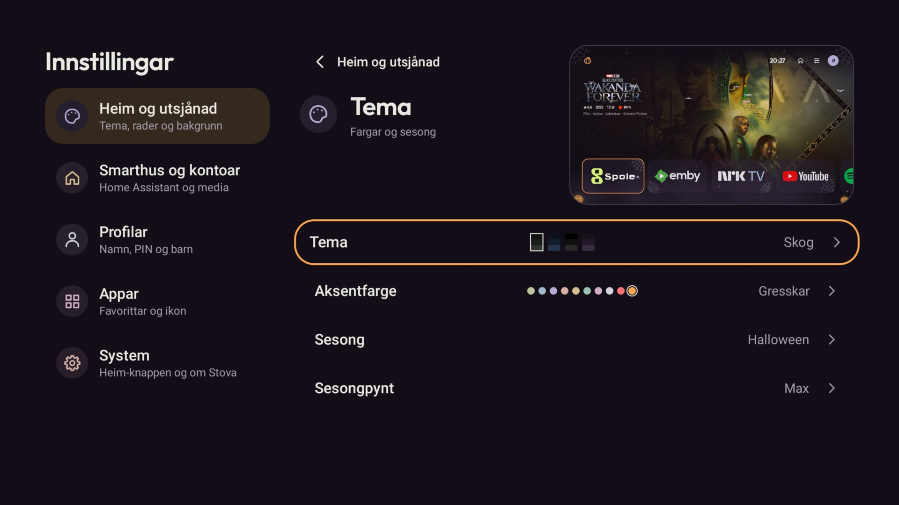

# Stova

Ein flat og rask Android TV-launcher for NVIDIA Shield. Stova viser filmar og seriar frå Jellyfin og Emby, har eigne profilar og eit lite Home Assistant-dashbord, og fjernkontrollen styrer alt. Spole opnar detaljar og spelar filmar og seriar.



## Dette kan Stova

- **Framsida:** ein stor hero med logo, fakta og bakgrunnskunst, favorittappar og mediarader som Hald fram, Nyleg lagt til og Watch Next. Heroen rullar bort med ein lett parallax når du går nedover, og radene blir bufra så Heim opnar raskt.
- **Tema og sesong:** fargetema og aksentfarge for kvar profil. Sesongpynten Max gjev Halloween og jul med pynt som rører seg, og spindelvev eller snø på kvar appflis. Pynten kviler etter to minutt utan tastetrykk.
- **Snøggmeny:** hald OK på Innstillingar-ikonet for nettverk, Bluetooth, bilete og lyd, lagring og omstart, med ekte status frå TV-en.
- **Appmeny:** hald OK på ein app for å opne, flytte eller skjule han, byte ikon eller fjerne han frå favorittane.
- **Snarvegar:** bibliotek frå Jellyfin og Emby, med biletet dei har der, og scenar og skript frå Home Assistant kan liggje i favorittrada saman med appane. Eit bibliotek opnar seg i Spole, ein scene startar med eitt trykk.
- **Smarthus:** Home Assistant-kort for vêr, straumpris, lys, mediaspelarar og varmepumpe, og statusbrikker i toppfeltet om du vil. Trykk OK på ei brikke for lys, musikk eller varmepumpe, så fell eit lite kort ned der Venstre og Høgre skrur lysstyrke, volum eller temperatur.
- **Profilar:** eigne val for kvar profil, PIN og barnemodus.
- **Heim-knappen:** Stova kan opne seg når du trykkjer på Heim, medan systemlauncheren framleis er tilgjengeleg.

For utviklarar og AI-agentar: [arkitektur og filkart](docs/ARCHITECTURE.md),
[arbeidsflyt og testar](CONTRIBUTING.md), [emulator og demodata](docs/EMULATOR.md),
[arbeidsreglar](AGENTS.md) og [planar](docs/superpowers/plans/README.md).

## Skjermbilete

Bileta er tekne på ein NVIDIA Shield med ekte appar, eit ekte Jellyfin-bibliotek og Home Assistant.

<table>
  <tr>
    <td width="50%"><br><b>Mediarader.</b> Kunst og framdrift frå Jellyfin, med bakgrunnen til kortet du står på.</td>
    <td width="50%"><br><b>Snøggmenyen.</b> Hald OK på Innstillingar for nettverk, Bluetooth, skjerm, lagring og omstart.</td>
  </tr>
  <tr>
    <td><br><b>Appmenyen.</b> Hald OK på ein app for å flytte, skjule eller fjerne han.</td>
    <td><br><b>Smarthus.</b> Home Assistant-kort som fjernkontrollen styrer.</td>
  </tr>
  <tr>
    <td><br><b>Innstillingar.</b> Fem kategoriar, og kvar side seier kva ho styrer.</td>
    <td><br><b>Tema.</b> Ei lita utgåve av Heim viser vala dine med ekte innhald.</td>
  </tr>
</table>

## Krav og oppsett

- Android TV 11 / API 30 eller nyare. Stova er laga for og prøvd på NVIDIA Shield. Chromecast med Google TV og andre Google TV-einingar skal fungere, men er ikkje prøvde.
- Jellyfin eller Emby for mediarader; Spole med støtte for `spole://open` for avspeling.
- Home Assistant for Smarthus (valfritt).
- Android SDK Platform-Tools på ei datamaskin for installasjon via adb.

Følg [oppsettdokumentet for Shield](docs/SHIELD_SETUP.md). **Ikkje slå av systemlauncheren.** Det finst enno ingen verifisert, signert 1.0-release frå dette arbeidet; Shield-målingar, signering og oppdateringstest står att.

## Bygg og verifisering

Bruk JDK 17 eller nyare og Android SDK 36. På Windows skal alle Gradle-kall gå via wrapper-skriptet, som set ASCII-stiar for cache og mellombelse filer:

```powershell
pwsh -NoProfile -File scripts/gradle.ps1 testDebugUnitTest lintDebug assembleDebug
pwsh -NoProfile -File scripts/Measure-Stova.ps1 -SelfTest
```

Debug-APK-en ligg i `app/build/outputs/apk/debug/app-debug.apk` og har pakkenamn `app.stova.debug`.

Baseline Profile og kaldstartbenchmark ligg i `baselineprofile/`. Sjå [målerapporten](docs/verification/plan-5-emulator.md) for emulatoroppsett, kommandoar, måltal og avgrensingar. Ytelsesbudsjetta gjeld signert release på Shield: kaldstart ≤ 900 ms, varm Home ≤ 300 ms, hakking ≤ 5 % og PSS ≤ 250 MiB.
