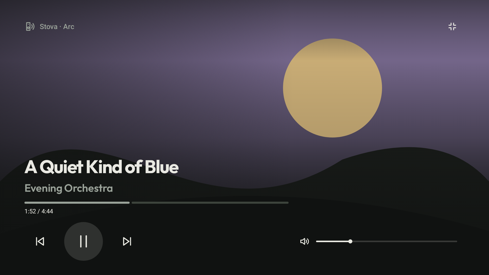
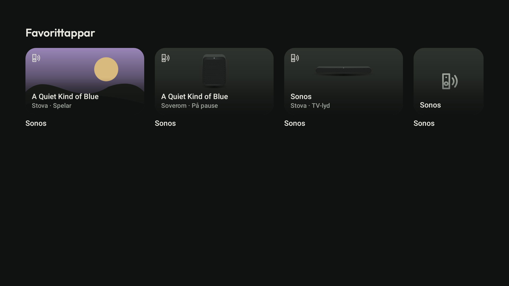

# Sonos og Music Assistant

Stova bruker Home Assistant til å finne og styre Sonos. Modulen er av som standard.
Han endrar ingen høgtalarar berre ved å bli opna.

## Oppsett

1. Legg til Sonos i Home Assistant og kontroller at romma er tilgjengelege der.
2. Kople Stova til Home Assistant under **Innstillingar → Smarthus og kontoar**.
3. Slå på **Aktiver Sonos** i same seksjon. Sonos får eiga side, ein snarveg på Appar
   og eit valfritt ikon i toppfeltet. Modulen gjeld vaksne profilar.
4. Vel om **Spelar no** skal visast saman med widgetane, og om albumkunst skal overta
   bakgrunnen på Heim medan musikken spelar. Desse er separate val. Heim-kunst er av
   som standard og følgjer profilen sitt val om å bruke bilete.

Widgeten viser musikk, romnamn og spel/pause. Trykk på omslaget eller tittelen for å
opne Sonos-sida. Han rullar vekk saman med resten av toppfeltet. TV-lyd blir ikkje vist
i widgeten. TV-lyd på ein aktiv Sonos-lydplanke sperrar også Heim-kunst, sjølv om
lydplanken framleis rapporterer det førre omslaget, eller eit anna rom spelar musikk.

## Musikk, favorittar og rom

Vel rom i venstre kolonne. Avspelingsknappane styrer musikken til gruppa, medan volum
og demping gjeld det valde rommet. Avspeling, volum og snarvegar får plass utan rulling
ved vanleg TV-skrift. **Fleire val** samlar demping, kjelder, tilfeldig avspeling, gjentaking
og hopping 15 sekund fram/attende når spelaren støttar det. Stor skrift kan framleis rulle.
Høgre frå romlista går til avspelingsknappane; Venstre frå den første går tilbake til valt rom. Innhaldet i **Musikk og favorittar** kjem frå Sonos gjennom HA.
Ei mappe opnar ei ny liste. Spelbart innhald kan startast eller leggjast til i køen
når spelaren støttar dette. Tilbake går opp eitt nivå, også etter ein lastefeil.

**Grupper rom** lagar eit utkast. Ingenting blir flytta før du vel **Bruk**.
Koordinatoren blir verande. Om gruppa er endra frå ein annan app, må romvalet opnast
att. Ein delvis mislukka operasjon stoppar vidare gruppeendringar og viser den faktiske
tilstanden frå HA.

## Tema og sesong

Sonos-sida, biblioteket og dialogane følgjer profilen sitt tema, aksent, avrunding og
fokus. Jul og Halloween bruker same sesongmerke og pynt som Heim; Av, Roleg og Max
fungerer som elles i appen. Redusert rørsle stoppar pynt og høgtalaranimasjon.
Albumkunst ligg bak eit slør i temafargen. Høgtalarane bevarer si matte produktfarge.

## Fullskjerm og volum

Knappen med fire hjørne øvst opnar **fullskjerm**: albumkunsten over heile skjermen, tittel og
artist, spel/pause og spor som ikon, og ei tynn volumlinje. Rommet står diskret øvst. Tilbake
(eller knappen øvst til høgre) går attende til Sonos-sida. Fullskjerm endrar ingenting i musikken.
Er bakgrunnskunst av for profilen, står omslaget til høgre i staden; utan musikk, ved TV-lyd eller
fråkopla står høgtalaren der, aldri gammal albumkunst.

Volumet er ei tynn linje utan tekst: Venstre/Høgre endrar med 2 %, og endringa blir send når du
slepp. TalkBack les «Volum · rom» og prosenten.

## Romlista og Sonos-kortet

Knappen **Gøym rom** øvst gøymer romlista, så omslaget og musikken får plassen og fokus går til
spel/pause. Når lista er gøymd, står det valde rommet på knappen (**Rom · Stova**); trykk på han
for å få lista attende med fokus på rommet. Valet blir hugsa når du opnar biblioteket og kjem
attende.

Sonos kan òg leggjast i favorittrada på Heim. Hald inne OK (eller Meny) på Sonos-flisa under
**Appar** og vel **Legg til i favorittar**; flytt og fjern som andre favorittar. Kortet viser
albumkunsten over heile flata, låt og «rom · status» (spelar, på pause, lastar, fråkopla eller
TV-lyd). TV-lyd og fråkopla rom viser aldri gammal albumkunst, men høgtalaren til rommet. Heile
kortet opnar Sonos-sida; det startar eller stoppar aldri noko. Kortet gjeld vaksne profilar og
krev at Sonos er på med Home Assistant.

## Høgtalarane

Kvart rom viser ei teikning av høgtalaren slik han faktisk ser ut, med modellnamnet ved volumet
og i gruppevalet. Modellen kjem frå einingsregisteret i Home Assistant, ikkje frå namnet på
rommet. Ukjende modellar får eit nøytralt motiv. Lyset på høgtalaren pustar sakte berre medan
musikk faktisk spelar; det viser ikkje lydnivået. Det står stille ved pause, TV-lyd, fråkopling
og med redusert rørsle.

## Music Assistant

Legg til Music Assistant i Home Assistant, slå på **Bruk Music Assistant** i Stova og
opne **Kople musikkspelarar**. Vel Sonos-rommet og den tilsvarande Music Assistant-spelaren.
Koplinga er eksplisitt; to spelarar med same namn blir ikkje kopla automatisk. Eitt MA-val
kan berre vere knytt til eitt Sonos-rom i oppsettet.

**Music Assistant** opnar biblioteket som HA gjer tilgjengeleg: til dømes album,
spelelister og favorittar. Spelehandlingar frå dette biblioteket går til MA-spelaren.
Når ein MA-kø er aktiv, kjem metadata og avspelingskontrollane derfrå. Sonos-favorittar,
fysiske kjelder, romvolum og Sonos-gruppering bruker framleis dei native Sonos-einingane.
TV-kjelda overstyrer ei gammal MA-kømarkering.

Innlogging i musikktenester, oppsett av Sonos og administrasjon av Music Assistant
skjer i dei respektive tenestene. Stova har ikkje eit eige musikkabonnement eller ein
direkte Music Assistant-servertilkopling. Innhald og støtta handlingar avheng av HA
og dei tilkopla tenestene.

## Kontroll før bruk på ekte høgtalarar

Kode og kontrollerte testar er skilde frå kontroll av eigaren sitt anlegg. Sjå
[verifiseringsloggen](verification/2026-11-03-sonos.md) for kva som faktisk er prøvd.
Kontroller avspeling, gruppering, omslagsadresser, TV-lyd og MA-koplinga på det aktuelle
anlegget før dette blir rekna som ferdig verifisert der.
