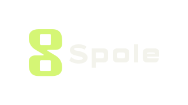

# Spole i Projectivy-stil

`spole-projectivy.svg` og `spole-projectivy.png` har transparent 320 × 180-lerret, som logoane
i Projectivy Icon Pack. SVG og Android-vektoren `ic_spole_projectivy.xml` bruker dei same seks
vektorstiane og dei same transformasjonane som Spole sitt eksisterande TV-banner. Berre
bakgrunnsstien er fjerna. Bokstavar og merke er ikkje teikna om.

Kjelde lest 25.10.2026: `C:/JellyBin/reelstack-android/app/src/main/res/drawable/tv_banner.xml`.
SHA-256 av originalfila: `b080614c763a2fc8ce6896b0592bd58f24f8affbf39847c18b0a476515571084`.
PNG er eksportert frå SVG med Sharp; han er ikkje ein nytolka eller biletegenerert logo.

Stova legg `stova_spole` til sin eigen katalog for pakken `dev.projectivy.blueprint.app`.
Det gir automatisk fallback for `app.reelstack` og `app.reelstack.debug`, og eit søkbart val i
ikonveljaren. Ein eventuell ekte Spole-mapping i ein framtidig Projectivy-versjon har prioritet.
Originalpakken blir installert separat og blir ikkje endra, signert om eller lagd i Stova-repoet.

Kjelde for pakken: [Projectivy Icon Pack](https://github.com/SicMundus86/ProjectivyIconPack),
[release 1.1.9](https://github.com/SicMundus86/ProjectivyIconPack/releases/tag/1.1.9).
APK: `Projectivy_Icon_Pack_1.1.9.apk`, versjonskode 119, 17 139 097 byte.
SHA-256: `c3343564f6ff7a5ab51542a086f52820997fadbf26d947c1d30c3ef7bdad2d83`.

I Stova: Innstillingar → Utsjånad → Ikon → Ikonpakke. Val av Projectivy byrjar utan kortbakgrunn.
Bakgrunn på appkort kan slåast på att. Breie logoar bevarer sideforholdet ved dekoding og vising.

