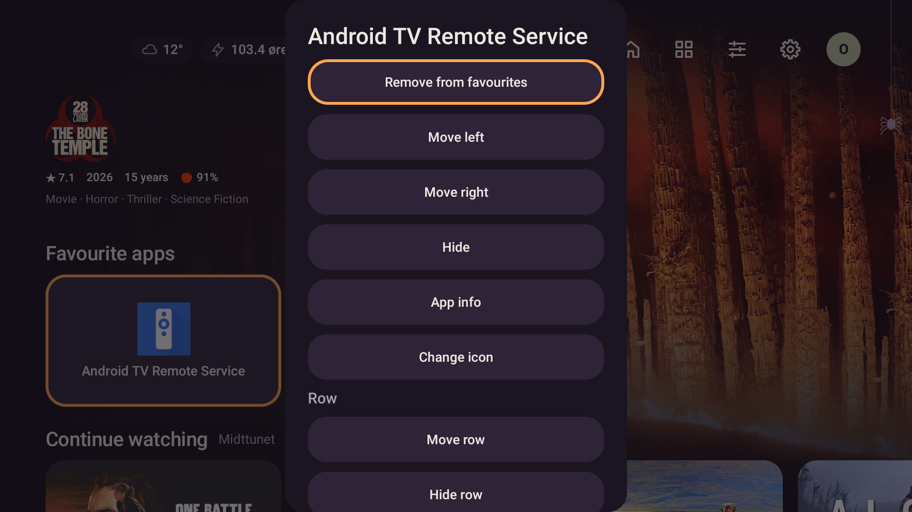

# Appmeny etter langt trykk

2026-10-25. Påvist med Android-nøkkelhendingar i dialogtesten: eit gjenteke OK-KeyDown frå
vindauget som opna menyen, følgt av KeyUp i menyvindauget, valde første handling og lukka menyen.
Den eksisterande mus-/touch-prøva fanga ikkje denne overføringa mellom vindauge.

`StovaDialog` registrerer no kva OK-/Enter-trykk som byrja med ei ny KeyDown i dialogen.
Repetisjonar og slepp som høyrer til eit anna vindauge blir etne opp. Nye trykk verkar straks,
og eit vanleg trykk som blir halde inne i menyen verkar framleis. Vindauget ryddar tilstanden
ved fokustap. Løysinga bruker inga tidsbasert sperre og gjeld også undermenyar.

Raud regresjon: første menyhandling vart utløyst av ein KeyDown med repeatCount=3 og KeyUp.
Grøne regresjonar dekkjer D-pad OK, Enter, numpad Enter, slepp utan eiga KeyDown, eit trykk som
byrjar inne i dialogen, og appmenyen si favorithandling. Sistnemnde kontrollerer både uendra
favorittar etter opningstrykket og lagring med første nye OK.

På emulator-5580 med ekte data er følgjande prøvd:

- Appmeny på Heim og Appar blir ståande etter ADB sitt lange OK.
- Touch-hald på Appar gir òg ein stabil meny.
- D-pad ned til «Endre ikon» og neste korte OK opnar undermenyen.
- Meny-knappen og Back fungerer. Kort OK opnar framleis appen; retur frå Android-innstillingane er prøvd.
- Profil- og kontofiler er byteidentiske før/etter på både emulator og Shield.

Ny APK er installert med `-r` på begge einingane. Shield viste YouTube under brukskontrollen;
det er derfor ikkje gjort ei full fysisk menyverifisering der. Den lengre overføringa av
repetisjonar mellom vindauge er verifisert med native KeyEvent i JVM-testane; ADB si vanlege
langtrykkprøve på emulatoren åleine gjenskapte ikkje denne feilen før rettinga.

Sluttkontroll gjennom `scripts/gradle.ps1 testDebugUnitTest -Pstova.screens=true lintDebug assembleDebug`:
571/571, ingen hoppa over. Lint 0 feil, 38 eksisterande åtvaringar og 1 hint. Debug-bygg OK.
Logg: `.superpowers/app-longpress-full-final.log`; raud/grøn dialogtest i `app-longpress-red.log`
og `app-longpress-green.log`.

Fulltesten avdekte tre testproblem som òg er retta: trådtrygg registrering av ikon-kall i ein
fake, eit gammalt «12»-assert etter endringa til «12 år», og ein Watch Next-test som måtte
vente på flytutsendinga før han endra løyvet. Ingen Watch Next-produksjonskode er endra.

APK: `app/build/outputs/apk/debug/app-debug.apk`.
SHA-256: `8cf162faac67fba4397d1277345e48024b8af077ff852c1caaf43d15f60c4d7a`.
