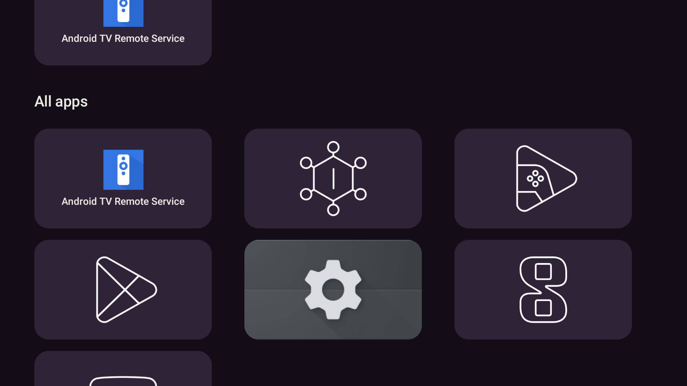
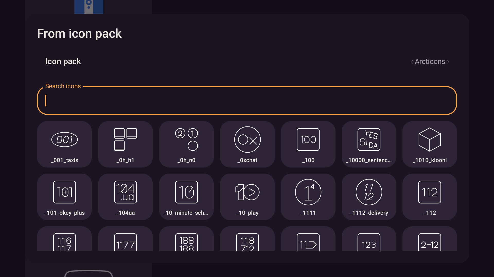
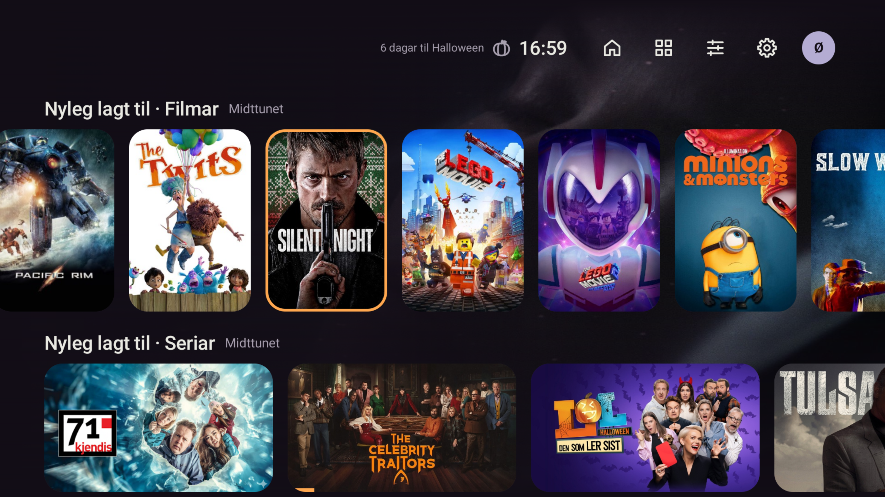

# Brukstest på emulator og Shield

2026-10-25. Ekte Midttunet-bibliotek og eksisterande profilar. Berre `emulator-5580`
og den uttrykkeleg tilgjengelege Shield-eininga vart brukte. Begge fekk debug-APK med
`install -r`; ingen kontoar vart sletta, systemlauncheren vart ikkje endra og ingen HA-einingar vart styrte.

## Rett feil i store ikonpakkar

Offisiell [Arcticons 15.3.2](https://github.com/Arcticons-Team/Arcticons/releases/tag/15.3.2)
vart installert berre på emulatoren. APK-digest vart kontrollert mot release-ressursen og signaturen
vart kontrollert med `apksigner`. Ikonveljaren stod og lasta, utan diskindeks, med om lag 104 % CPU.

Ein samplingsprofil peika på `MatcherNative.setInputImpl` gjennom Kotlin `MatchResult.next()`.
På Android kopierer reset heile XML-strengen for kvart treff. `AppFilter` brukar no éin Java-matcher
med `find()` for heile katalogen, og bevarer toleransen for skadde enkeltoppføringar.

Ny `AppFilterDeviceTest` køyrer på Android med 30 000 komponentar og ein tilsvarande ikonliste.
Før rettinga: tidsavbrot etter 15 sekund, med stack i ICU sin input-reset. Etter rettinga:
1/1 grøn på 8,548 sekund inkludert testoppsett. JVM-testane for parser og diskbuffer er òg grøne.

Ekte verifisering: automatisk ikonval, originalikon ved manglande treff, Spole sitt linjeikon,
søk etter `jellyfin`, val med D-pad og lagra overstyring. Overstyringa vart sletta og global
ikonpakke sett tilbake til det opphavlege «Ingen». Arcticons er framleis installert og kan veljast.




## Framdrift ved retur frå spelaren

Femminuttsbufferen heldt gammal framdrift etter retur frå Spole; omstart henta den nye verdien.
Ei vellukka tittellenkje markerer no profilen som endra, også når eldre Spole opnar si eiga startside.
Neste oppdatering hentar mediaradene éin gong. Spotlight brukar framleis sin eigen buffer, og andre
profilar blir ikkje ugyldige. Ein revisjonsteljar bevarer ei ny markering som kjem medan ein førespurnad køyrer.

Regresjonstest: ferske rader blir brukte om att, ein annan profil har ingen effekt, spelarretur
hentar ny framdrift, og påfølgjande vanleg retur brukar buffer. Før implementeringa mangla denne kontrakten;
etterpå er MediaRepositoryTest 21/21 grøn.

På emulatoren opna D-pad/OK riktig film i Spole debug. Spelaren gjekk til `PLAYING`, og Back kom
tilbake til Stova. Siste prøve endra framdrifta frå `0.12085405` til `0.12193981`, med under fire
minutt mellom dei to oppdateringane og utan omstart. Shield henta deretter same nye framdrift frå biblioteket.
Avspeling hadde bufferstopp under emulatorprøvene; dette er ikkje ei godkjenning av spelarytelse.
Kontofila har identisk SHA-256 før og etter på kvar eining. Ingen nye testprofilar vart lagde inn.
Den eksisterande profilveljaren vart opna og eksisterande vaksenprofil valt igjen; PIN/barneprofilar
vart prøvde i automatiske testar. Fråkopla rader vart observerte under mellombelse nettverksproblem,
og oppdaterte rader kom tilbake då tenaren svarte.

## Fysisk Shield

Endeleg APK vart prøvd med D-pad opp/ned og ti steg bortover ei lang filmrad. Heroen rullar heilt
ut av vegen, fokus følgjer korta og fleire rader får plass. Retur frå Spole og Home til eksisterande
systemlauncheren vart prøvd. Stova er ikkje sett som ny systemlauncher.



Installert Spole `1.0.0-beta20` på Shield har ingen mottakar for `spole://open`.
Stova opnar derfor Spole si startside og viser oppdateringsmeldinga. Direkte tittellenkje og
avspeling frå ei slik lenkje må prøvast igjen med kompatibel Spole på Shield.

Målinga brukte debug-bygget ved starten av prøvene, før parser-/framdriftsrettingane, med same Heim-layout:

| Måling | Resultat | Release-mål |
|---|---:|---:|
| Kaldstart, median av ti | 2138,50 ms | ≤ 900 ms |
| Varm Home | 348 ms | ≤ 300 ms |
| Hakkande ramer, 30,55 s med D-pad | 4,15 % | ≤ 5 % |
| PSS etterpå | 182,98 MiB | ≤ 250 MiB |

Dette godkjenner ikkje release-budsjetta. Starttidene overskrid måla i debug og må målast på nytt
med signert, optimalisert release. Måleskriptet er retta til å slå opp startaktiviteten, sidan
debug-pakken heiter `app.stova.debug` medan aktivitetsklassen heiter `app.stova.MainActivity`.
Skriptets sjølvtest er 27/27 grøn.

## Bygg, testar og signering

Alle Gradle-kall gjekk gjennom `scripts/gradle.ps1`:

```powershell
pwsh -NoProfile -File scripts/gradle.ps1 testDebugUnitTest lintDebug assembleDebug
pwsh -NoProfile -File scripts/gradle.ps1 testDebugUnitTest --tests 'app.stova.AppScreensTest' --tests 'app.stova.ha.ui.HaScreensTest' --tests 'app.stova.ScreensTest' '-Pstova.screens=true'
```

Første køyring: 513 beståtte og 45 skjermtestar hoppa over av standardinnstillinga.
Andre køyring: alle 45 skjermtestane beståtte utan hopp. Til saman 558/558 ulike JVM-/skjermtestar
utførte og beståtte. I tillegg Android-regresjonen 1/1. Lint: 0 feil, 38 åtvaringar og 1 hint.
Debug-bygg er grønt. DesignRulesTest er 5/5 grøn.

`assembleRelease` stoppar som venta i `verifyReleaseSigning` når eigaren sitt signeringsoppsett
manglar. Konfigurasjonsbufferen fungerer både for denne sperra og debug-bygg.
Oppsett og trygg lokal passordinntasting er dokumenterte i [RELEASE_SIGNING.md](../RELEASE_SIGNING.md).
Ingen produksjonsnøkkel vart generert. Signert release, måling av det bygget og oppdatering over
ei tidlegare utgåve med same produksjonssertifikat står att.

Endeleg debug-APK: `app/build/outputs/apk/debug/app-debug.apk`.
SHA-256: `1f3f7815146bd2217eb58e4b3019d8691e00e9bbb9509425fd57fd87364a52e2`.
Lokale TDD-, måle- og testloggar ligg i git-ignorert `.superpowers/`.
