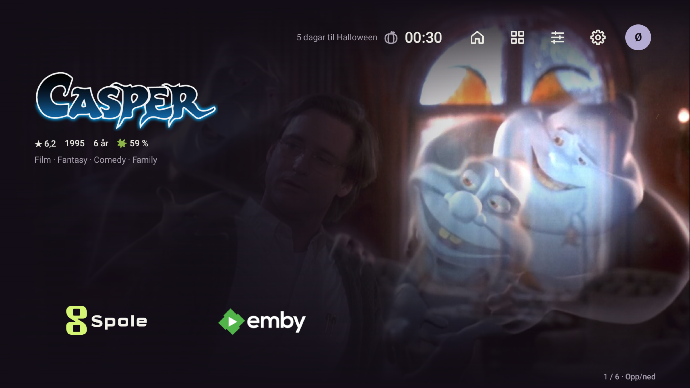
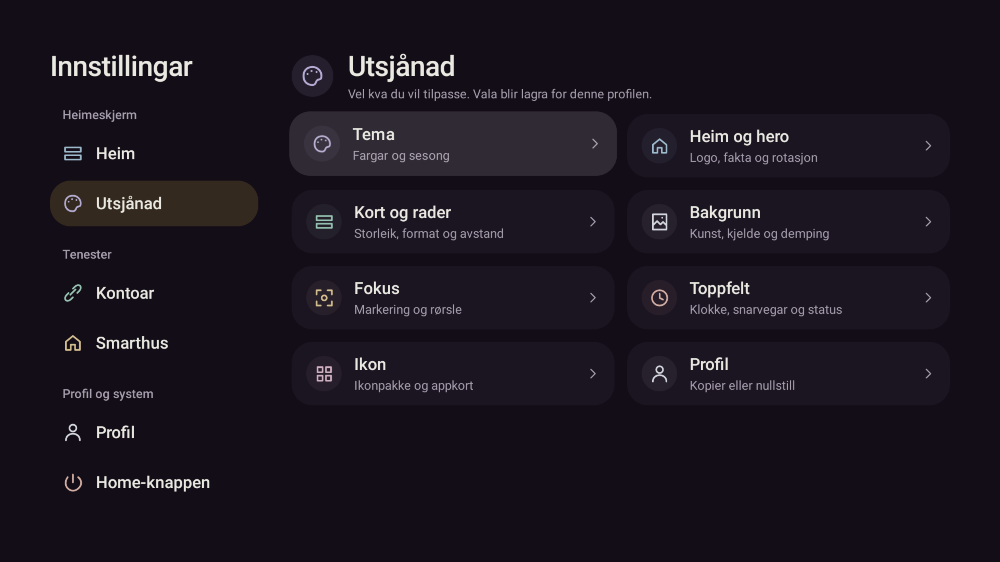
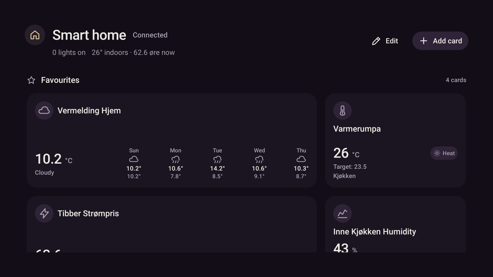
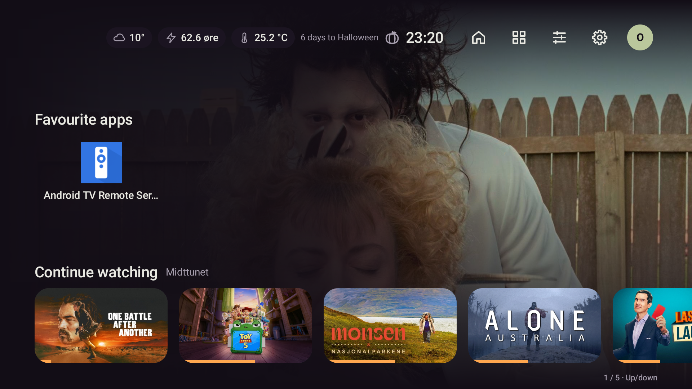

# Radfelt og visuelt system – 26.10.2026

Bestillinga er utført etter `2026-10-25-cinematic-visual-system.md`.
Kode: `ec0d1cb`, `f827f13`, `6486304`, `0dcd25e` og `eb5d1e3`.

## Det som er endra

- Heim viser éi heil rad nedst som standard, også for eldre profilar. Ingen neste rad
  stikk inn i kvile. Opp/Ned når alle ikkje-tomme rader, medan heroen står over feltet.
  Utsjånad → Heim og hero har Éi rad / To rader / Rullande oversikt og tre høgdeplasseringar.
  To rader tilpassar kunsten proporsjonalt. Stor skrift eller trong plass gir éi heil rad;
  heroen blir utelaten når radene treng plassen. Valet i profilen blir ikkje skrive om.
- Meny, kategorioversikt og detaljsider deler symbol. Innstillingane har éi overskrift,
  opne rader og små prøver av radvising, format, storleik, hjørne, avstand og fokus.
  Berre Høgre/OK endrar valet; Venstre går til seksjonsmenyen. Standard/fokusprøvene
  viser same symbol og effekt som faktisk blir brukte.
- Appar, profilar, app-/medie-/radmenyar og Smarthus deler overskrifter, ikon og kompakte
  handlingar. Små HA-kort gir namnet full tekstbreidd under statusrada. Breie vêrkort held
  den kompakte 152 dp-kontrakten. Rom/Favorittar og korttal har faste tekstkantar.
- Fokus blir bevart ved byte av radvising og retur til ein film som finst i fleire rader.
  Lange tenarnamn får same breiddegrense i måling og teikning. Faktisk Smarthus-prøving
  fann at første kort kunne rulle bort gruppeoverskrifta; første band held no gruppa med seg.
- Den delte mjuke rørsla frå førre steg er bevart: avbrytbar 560 ms rulling, roleg
  side-/dialoginngang og lagbasert fokus. Redusert rørsle gir omgåande flytting.

## Verifisering

Raude prøver vart køyrde før implementering av standardvisinga, menyikon, kategorioverskrift,
radval, modus-/returfokus og gruppeoverskrift på eit dashbord som må rulle.

Endeleg kommando:

```powershell
pwsh -NoProfile -File scripts/gradle.ps1 testDebugUnitTest lintDebug assembleDebug '-Pstova.screens=true'
```

**645/645 testar, 0 feil og 0 skip.** Lint: **0 feil**, 46 åtvaringar og 1 hint.
Native skjermprøver er køyrde for alle kategoriar, dobbel skrift, radformat/overskrifter,
hero Av/omtale, éi/to rader, rullande oversikt, Smarthus/kort, Appar og profilar.
Dette er render- og interaksjonsprøver, ikkje piksel-baseline-samanlikningar.

Den fulltesta APK-en er installert med `-r` på `emulator-5580` (Stova_TV) og Shield.
Lokal APK og begge installerte APK-filer har SHA-256:

```text
aa9acb9140387cf4baabd4cfa3533ee82e35d4bc6dfc9784d41f739b4aab2627
```

APK-kopi: `.superpowers/cinematic/stova-cinematic-debug.apk`.
Ingen andre emulatorar vart brukte.

### Faktisk UI med ekte data

- Emulator: éi/to/rullande radvising, alle tre plasseringar, Opp/Ned og rask reversering,
  retur til same rad, Heim → Utsjånad, kategoriar, appmeny og Appar → Heim.
  Standard éi rad/Nedst er sett tilbake etter prøvinga.
- Smarthus på emulator: Favorittar med fire kort, breitt vêr-/straumkort, små klima-/sensorkort,
  piler og kortmeny. Gruppeoverskrifta er synleg med første band i den siste pakken.
- Shield: éi rad med eksisterande Spole-/Emby-kunst og eigne radval; Heim → Utsjånad,
  Fokus-kategorien, Tilbake og Smarthus med tomt dashbord. Ingen val vart endra der.
- D-pad vart sendt med ADB. Visuell kontroll er gjort på faktiske skjermbilete og opptaksrammer;
  fysisk fjernkontroll og HDMI-vising er ikkje målte som eit eige ytelsessteg.

Opptak i `.superpowers/cinematic/`: `emulator-row-motion.mp4` (12,058 s, 1280 × 720)
og `shield-row-motion.mp4` (12,188 s, 1280 × 720). Mellomrammer er kontrollerte, inkludert
snudd retning før førre radbyte er ferdig. Opptaksfrekvens er ikkje brukt som bevis på app-ytelse.

### Bevarte data

Shield sine `profiles.json`, `media-accounts.json` og `household.json` er byteidentiske før/etter.
På emulatoren er konto- og hushaldsfilene byteidentiske. Profilprøvinga serialiserte dei to nye
felta `homeRows=ONE` og `homeRowInset=LOW`; samanlikning av alle andre profilfelt er identisk.
Ingen HA-einingar vart styrte, appar/favorittar endra eller media spela. Ingen push/publisering.
Begge einingane står på Heim.

## Bilete





