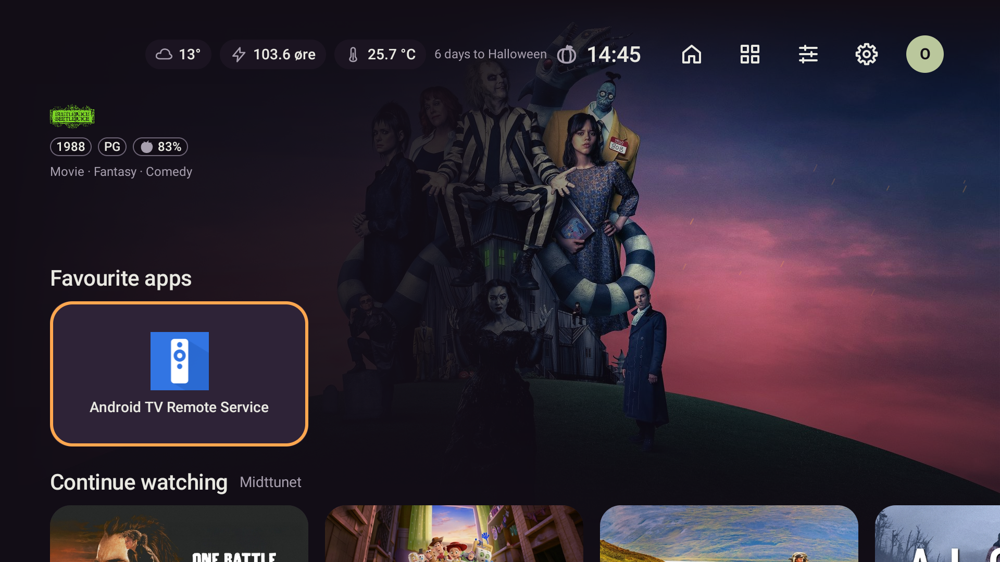
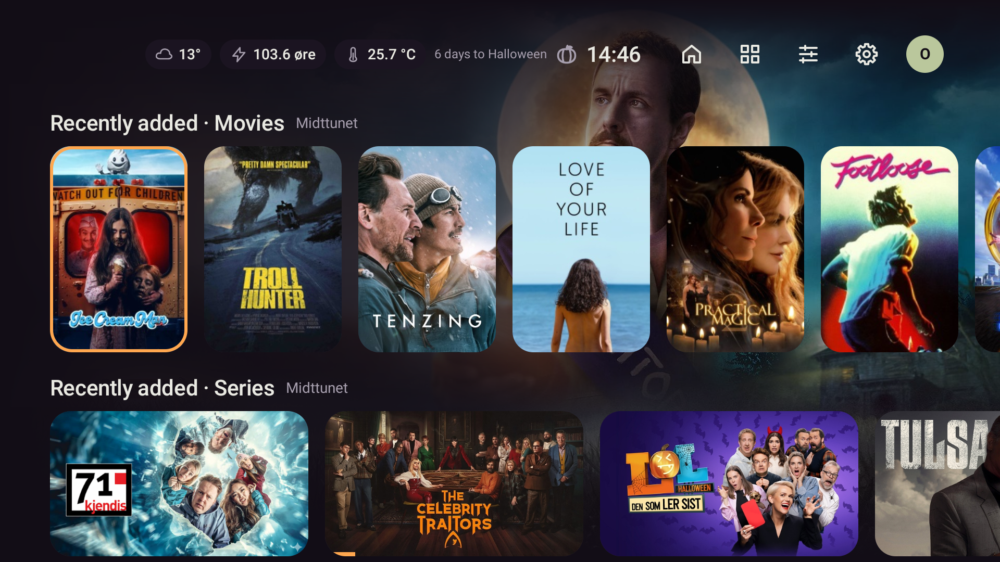
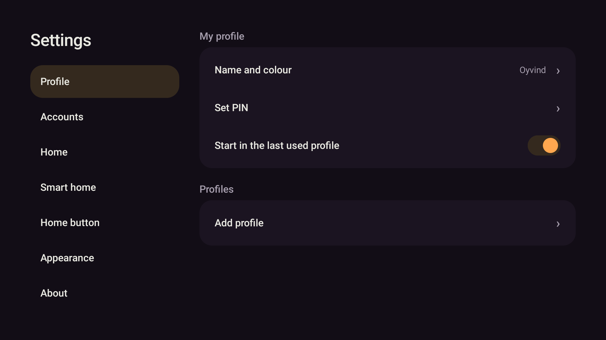
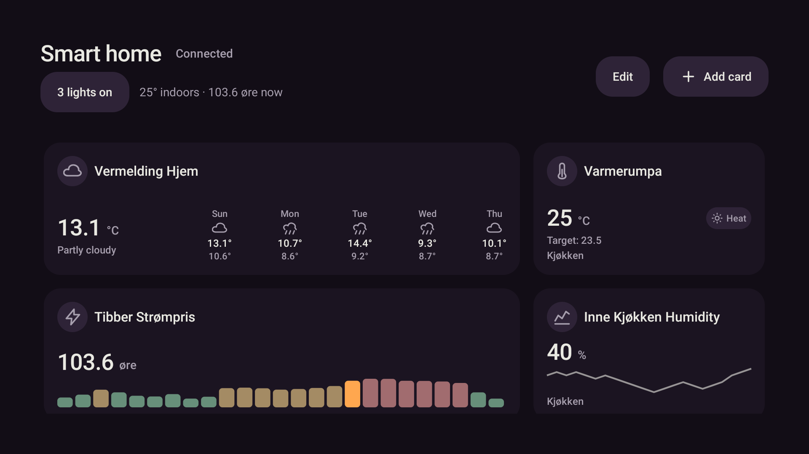

# Design og vedlikehald – 25. oktober 2026

## Resultat

Claude sine uferdige kjerne-, HA- og rørsleendringar er fullførte og samla. Heim har ei rullande
parallax-overskrift som slepper plassen når fokus går nedover. Innstillingane har fast overskrift,
og dei største skjermfilene er delte etter ansvar. Arkitektur, filkart og arbeidsflyt er dokumenterte.

## Automatiske kontrollar

```powershell
pwsh -NoProfile -File scripts/gradle.ps1 testDebugUnitTest lintDebug assembleDebug '-Pstova.screens=true'
```

**556/556 testar bestått, ingen hoppa over, ingen feil.** Lint: 0 feil, 38 åtvaringar og 1 hint.
Debug-APK bygd. Testane omfattar rørsletokens, dialogfokus og bakgrunnstrykk, navigasjon, parallax
ned/opp, korte lister, fokusretur, logo som feilar, stor skrift, mediaførespurnader og HA-behov/buffer.
Skjermtestane skreiv PNG-filer til `app/build/screens/`; dei kontrollerte emulatorbileta nedanfor
er eigne opptak med verkelege data.

Siste visuelle justering gir logoen ei tydeleg avgrensa visingsflate. Etterkontroll av
`app.stova.home.*` og `app.stova.navigation.*`, lint og debug-bygg:
**81/81 bestått, ingen hoppa over, lint 0 feil og bygg OK**. Dette omfattar også regresjonstesten
for å hente heroen fram att ved fokus til topplinja etter oppstart direkte på ei medierad.
Den endelege debug-APK-en er installert med `-r`; SHA-256:
`4bd51bcf8070c3d08487373139fa9e10ac31ad5b2a7d4ac0776d5cc68dac0051`.

## Emulator med ekte data

Berre `emulator-5580` (`Stova_TV`) er brukt. Oppdatering med `adb install -r` bevarte dataa.
SHA-256 for både `profiles.json` og `media-accounts.json` var identisk før og etter oppdatering
og navigasjonsprøva. Ingen avinstallering, nullstilling, demoseeding eller installasjon på Shield.

- Verkeleg Jellyfin-bibliotek, kunst og rader vart viste. Bufra rader er tilgjengelege under nettverksoppdatering.
- D-pad ned gir radene plassen under topplinja; heroen er ute av syne. Opp til første rad viser han att.
- Heim, Innstillingar og Smarthus kan opnast og lukkast med bevarte kontoar og profilval.
- Ekte HA viste tilkopla status, vêr, temperatur, fukt og Tibber-graf. Ingen styringshandlingar vart sende i layoutprøva.
- Redusert rørsle og skriftstorleik 2 er kontrollerte med automatiske UI-testar.

| Øvst på Heim | Etter rulling |
|---|---|
|  |  |

| Innstillingar | Smarthus |
|---|---|
|  |  |

## Struktur

`HomeScreen` og `SmartHomeScreen` koplar til data og livssyklus; `HomeContent`, `HomeRows`,
`SmartHomeContent` og `SmartHomeCardMenu` eig vising og lokal interaksjon. Utsjånad er delt i
datakopling og kontrollerte innstillingar. `HomeChips` isolerer HA-oppdateringar. `HaReadCache`
og `HaSnapshotWriter` eig bufferreglane. Sjå [arkitekturoversikta](../ARCHITECTURE.md).

Ingen nye rammeverk eller avhengigheiter. JSON-format og pakkenamn er bevarte. Signert release,
oppdatering på fysisk Shield og Shield sine ytelsesbudsjett er framleis eigne, uverifiserte release-steg.

## GitHub

Nytt repo: [oyvhov/stova-android](https://github.com/oyvhov/stova-android). Privat status er
stadfesta gjennom GitHub API. Push og fjern-commit blir stadfesta ved ferdigstilling.
