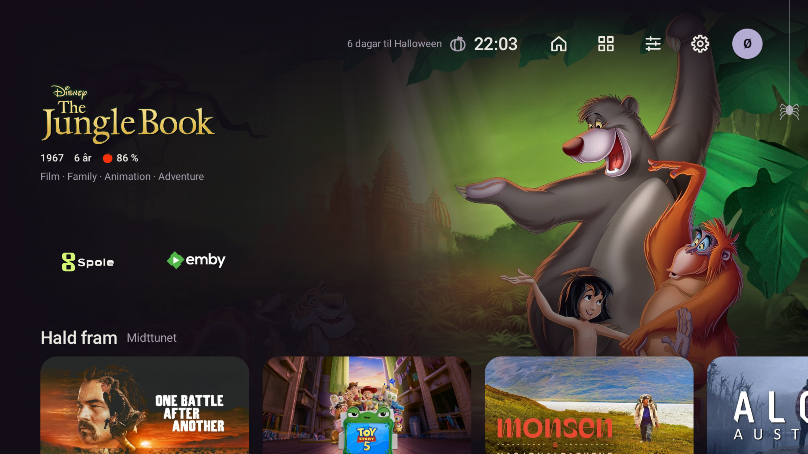

# Fast piltastnavigasjon og fokus utan glød – 25.10.2026

Bestillinga gjeld gløden rundt kort og navigering som stoppar eller hoppar feil i toppfelt,
Smarthus og menyar. Tre agentar arbeidde parallelt med Innstillingar, Smarthus og Spole;
hovudagenten eigde Heim, fokusstilen, samla testar og einingsprøvene.

## Endringar

- Fokusskuggen er fjerna heilt. Kunst bruker berre 2,5 % forstørring og 2 dp løft;
  menyval har 1,5 % forstørring og svak lysare flate. Transparente logoar får inga ekstra flate.
- Heim: Ned frå alle toppkontrollane går til første ikkje-tomme rad. Opp/Ned følgjer radene;
  Opp frå første rad kjem tilbake til førre toppkontroll. Eit nyare piltrykk avbryt ei
  ventande flytting til ei rad som må rullast inn. Radflytting i redigeringsmodus er bevart.
- Innstillingar: berre vald seksjon ligg i fokustreet. Sidekolonnen har faste Opp/Ned-lenkjer,
  Høgre/OK går inn i seksjonen, og Venstre ved kanten kjem tilbake til vald seksjon.
  Venstre mellom kontrollar i same rad og i tekstfelt blir handtert av kontrollen først.
  Ventande innstikk blir avbrote av ny Venstre/Opp/Ned, også ved ytterkanten av menyen.
- Smarthus: same kortpakking gir logiske rektangel for fokus. Pilene følgjer næraste neste
  rad/kolonne og tek omsyn til store kort. Kort utanfor skjermen blir rulla inn før fokus.
  Opp til toppkontrollane og Ned tilbake til førre kort er eksplisitte vegar.

## Automatiske prøver

Før retting feila tastetestane for topp → apprad, Smarthus-topp → kort og scrolleinnhald →
rett menyseksjon. Ekstra regresjonar fanga Venstre mellom kontrollpar og forseinka fokus
etter raske retningsskifte. For å prøve fleire trykk før neste ramme bruker dei siste testane
`keyDown`/`keyUp` utan tidssteg; `pressKey` flyttar testtida og let neste ramme køyre.

Sluttkommando:

```powershell
pwsh -NoProfile -File scripts/gradle.ps1 testDebugUnitTest lintDebug assembleDebug '-Pstova.screens=true'
```

609/609 testar bestått, 0 hoppa over. Lint: 0 feil, 39 åtvaringar, 1 hint. Debug-bygg OK.
Native skjermprøver ligg i `app/build/screens/`, mellom anna `focus-calm-focused.png` og
`focus-calm-reduced-motion.png`; begge er opna og kontrollerte visuelt.

APK: `app/build/outputs/apk/debug/app-debug.apk`.
SHA-256: `a05d0c47931a9f57a8e1e25f1a5fae134f6bd09c89ba09bf1483e47478e75297`.
Installert med `-r` på emulator-5580 og Shield; installert APK-hash er lik på begge einingane.

## Ekte data og D-pad

Emulator-5580:

- Ned frå Apps, Settings, Android settings og Switch profile når apprada; Opp returnerer
  til same ikon. Heim-brikka er i tillegg dekt av testane og på Shield.
- Smarthus: topp → vêrkort → klimakort → fuktkort → straumpriskort → neste lyskort;
  Opp returnerer til førre band. Berre fokus vart flytta, ingen HA-styring vart utført.
- Innstillingar: profilinnhald og lang Heim-liste, Venstre tilbake til seksjonen, nedre
  sidekolonnegrense og Høgre på den passive Om-sida.
- Touch-hald på appkort opnar appmenyen. Ned flyttar mellom menyvala, menyen held seg open,
  Back returnerer til kortet utan å endre favorittar.

Shield (`192.168.10.182:5555`):

- Alle fem toppikon → Ned til Spole i apprada → Opp til same ikon, med native D-pad-hendingar.
- Emby-kortet er kontrollert utan fokusskugge; originale ikonfargar og transparent bakgrunn.
- Profil- og Heim-innhald, lange lister, Venstre tilbake til rett seksjon, sidekolonnegrense
  og passiv Om-side er prøvde. Venstre frå eit kontrollpar blir fyrst i paret, deretter i menyen.
- Touch-hald på Emby opnar appmenyen; piler navigerer, og Back går tilbake til Emby.
  Eit ekte halde-OK frå den fysiske fjernkontrollen er ikkje generert av denne ADB-prøva.
- Smarthus er tilkopla, men Shield-profilen har ingen kort. Den tomme sida held fokus på
  Legg til kort; det er ikkje lagt inn prøveinnhald eller endra HA-einingar.



## Bevaring av data

Profil- og kontofiler er byteidentiske før/etter denne navigasjonsrunden på begge einingane.
Favorittar og overstyringar er dermed bevarte. Konto-SHA-256:

- Emulator: `3c9f639a5604262c8747ac1d0ee0f40c65dc31b2d07b489756d7d4f4de485b1c`.
- Shield: `2be55c39a5d4fc7ddf3ba971defaeaec85336d32d5c3e737249e2a6706ff7517`.

Eigaren sine radformat på Shield vart endra mellom den tidlegare ikoninstallasjonen og
denne runden; dei er bevarte. Ingen datatømming, avinstallasjon, endring av standardlauncher
eller publisering/push.

Eigaren endra òg app-radformat under sluttutprøvinga. Etter koordinert fjernkontrollpause er
sluttkontrollen lik før-kontrollen på alle andre profilfelt og favorittar; berre
`home.rowFormats.apps.format` er endra. Kontofila har framleis same SHA-256.

## Spole-kortopning – endeleg prøve

Spole beta22/159 er installert på Shield med same eigarnøkkel og `install -r`.
APK-hash på eininga er `f309682bc23f04535877fe0a54624950037d234893f1b77b86957788447351e8`;
opphavleg installasjonstid 10.09.2026 er bevart. Kjeldecommit: `830cd4d` i
`C:/JellyBin/spole-launcher-link`.

Beta21 opna direkte varm/kald ADB-lenkje, men faktisk Stova-korttrykk kunne hente fram
Spole-framsida. Android kan levere rå lenkje til ein eksisterande hovudaktivitet ved
gjenbruk av oppgåva. Beta22 validerer slike lenkjer gjennom same konto-/sessionsgrense,
og den kortliva mottakaren har separat task-affinity.

Faktisk fokusert «One Battle After Another» i Stova → OK → rett detaljside er prøvd både
med Spole alt køyrande og etter `force-stop` av Spole. Kvar prøve ventar forbi oppstartsbiletet
og krev både rett tittellogo og detaljkontrollen «Trailer»; Jellyfin og «Hald fram · 143 min att»
er synlege. Ingen avspeling. Back frå detaljsida viser Spole si framside; Stova er deretter sett
fram att med eksplisitt appstart. Dette blir ikkje framstilt som direkte Back-retur til Stova.

Spole-sluttkontroll: 1293 testar bestått, 1 eksisterande LAN-test hoppa over, lint 0 feil,
signert release-bygg OK. Full rapport og lokalt artefaktarkiv finst i Spole-worktree-et.
