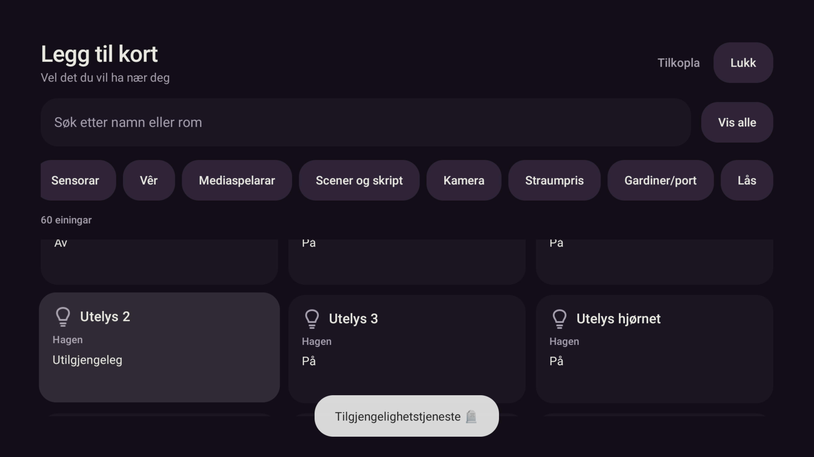

# Smarthus: fokus frå kategoriar til einingar – 25.10.2026

Eigaren melde at ein ikkje kom ned på einingane i Smarthus. Den faktiske skjermen var
«Legg til kort». Førre retting hadde berre dekt Smarthus-dashbordet.

## Påvist feil

På Shield hadde «Kamera» fokus i den horisontalt rulla kategorilista. Eitt native
`KEYCODE_DPAD_DOWN` flytta fokus til «Straumpris» til høgre i same liste, medan einingane
var synlege under. Same feil vart gjenskapt på emulator-5580, med ein katalog på 697 einingar.
Tre nye tastetestar feila før retting.

## Retting

Søk/Vis alle → kategoriar → einingsrutenett har eksplisitte Opp/Ned-vegar. Kategorifokus
er skilt frå valt filter: å fokusere «Kamera» vel ikkje kamerafilteret. Frå første einingsrad
går Opp tilbake til førre kategori, også når kategorilista er rulla sidelengs.

Rutenettet bruker same `CardFocusCell`/`cardFocusNeighbor` som dashbordet, med tre kolonnar.
Rulla innhald blir komponert før fokus blir bede om. Einingar som alt er lagde til, blir hoppa
over. Tomme/fråkopla lister held fokus på kategorien; lastefeil har ein veg til «Prøv igjen».
Pilnavigering legg ikkje til kort og sender ingen styringshandlingar.

## Verifisering

```powershell
pwsh -NoProfile -File scripts/gradle.ps1 testDebugUnitTest lintDebug assembleDebug '-Pstova.screens=true'
```

616/616 testar bestått, 0 hoppa over. Lint: 0 feil, 39 åtvaringar og 1 hint.
Debug-bygg OK. Dei ni veljartestane dekkjer mellom anna rulla kategoriar, synleg vertikal
rekkjefølgje, einingar som alt er lagde til, lange lister/ytterkantar, fråkopling og ny lasting.
Regresjonane krev null kall til `onAdd`, `onDone` og HA-tenester ved pilnavigering.

Endeleg APK: `app/build/outputs/apk/debug/app-debug.apk`, SHA-256
`a25e7e61171514de7113fb544bf58f8312b0fb48c9379b14b34b8a84af38d327`.
Installert med `-r` på emulator-5580 og Shield; installerte hash-ar er like den lokale fila.
Ei kopi av det testa APK-et ligg òg git-ignorert i
`.superpowers/entity-picker-focus/stova-entity-picker-debug.apk`.

Shield: «Lys» vart valt som filter, medan den horisontalt rulla kategorien «Kamera» berre
fekk fokus. Ned → Arkja; Opp → Kamera; Ned tilbake til Arkja; fire vidare Ned-trykk nådde
Badet, Gangen oppe 2, Outlander parkeringslys og Utelys 2. Heile einingskortet er synleg
etter rulling. Ingen eining vart aktivert eller lagd til. Shield er etterlaten i veljaren,
og eigaren er varsla om at han kan prøve.

Emulator-5580 med same endelege APK: søk → Alle → rulla Cameras → Arkja → Opp tilbake
til Cameras. Ny Ned og fire vidare radskifte nådde Vaskemaskin Power i den ekte katalogen
på 697 einingar. Ingen eining vart aktivert eller lagd til.



Profil- og kontofiler er byteidentiske før/etter runden på begge einingane. Ingen
datatømming, avinstallasjon, HA-styring, endring av standardlauncher eller push.

Resultata gjeld APK-hashen ovanfor. Nye endringar i utsjånad/innstillingar som dukka opp
i det delte arbeidstreet etter sluttbygget, er bevarte og inngår ikkje i denne commiten.
