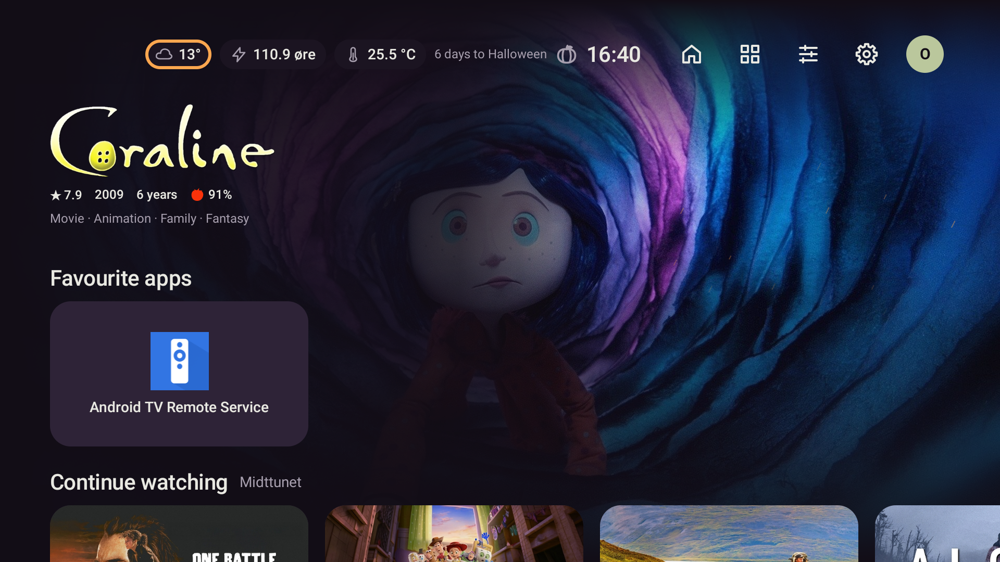
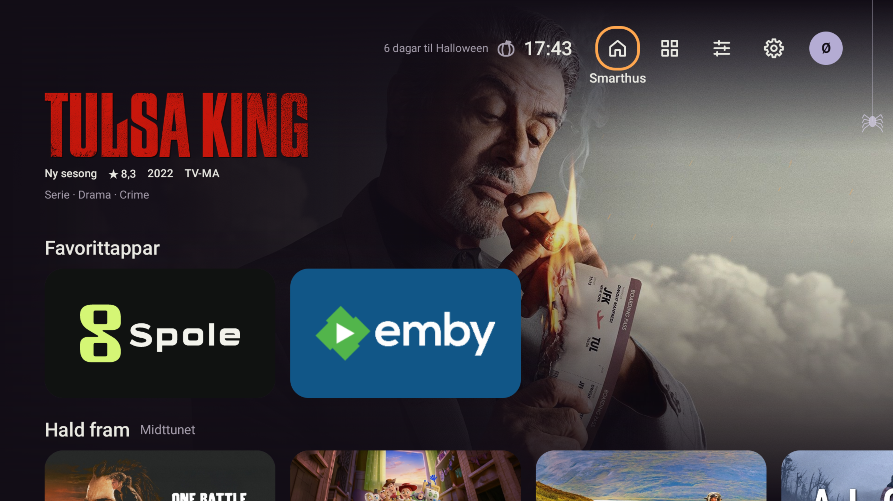

# Større medielogo i heroen

2026-10-25: tittel-logoar vart av og til svært små, særleg høge logoar med fleire linjer.
`HeroPanel` trekte frå ein fast tekstreserve på 110/150 dp. I avgrensa heroar vart resultatet
berre 24 dp høgde (26 dp med omtale), sjølv om det fanst plass til meir.

Teksten blir no målt først av den vanlege Column-layouten. Logoen fyller plassen som er att,
avgrensa til 360 × 96 dp. Både transparent trimming og `ContentScale.Fit` er bevarte, så heile
logoen blir vist med opphavleg sideforhold. Logo, lasting og feilreserve deler same ramme.
Herohøgda og plasseringa av mediaradene er uendra; parallax rullar framleis heile heroen bort.

Tre nye layoutprøver brukar ei lokal, polstra PNG-fil i kontrollert JVM-UI: kompakt hero,
hero med omtale og dobbel skriftstorleik. Før rettinga feila dei to første på 24 og 26 dp mot
minst 48 dp. Etterpå består alle tre, inkludert kontroll av at fakta og omtale får plass.

Sluttkontroll gjennom `scripts/gradle.ps1`: 93/93 Heim-, media-UI-, design- og relevante
AppScreens-testar bestått, 0 hoppa over, med `-Pstova.screens=true`. Lint: 0 feil,
38 eksisterande åtvaringar og 1 hint. Debug-bygg OK. Kommando og TDD-loggar:
`.superpowers/hero-logo-red2.log`, `hero-logo-green.log`, `hero-logo-final.log`.

Skjermprøvene omfattar vanleg hero, dobbel skrift, omtale, lys/medium/mørk bakgrunn,
stor posterrad, store kort med titlar og små ikon. Gjennomgåtte døme ligg i
`app/build/screens/appearance-overview.png` og `app/build/screens/11-home-media-font-2.png`.

Endeleg APK vart installert med `-r` på emulator-5580 og Shield med ekte bibliotekdata.
På Shield målte logoramma til Ash vs Evil Dead 70,5 dp etter rettinga; same vising hadde 24 dp før.
Favorittrada byrja framleis ved y=579 og D-pad ned flytta mediarada til y=281 medan heroen forsvann.
Profil- og kontofiler har identiske SHA-256 før og etter denne bestillinga på begge einingane.

APK: `app/build/outputs/apk/debug/app-debug.apk`.
SHA-256: `beff6d758088ca51253ddb30afaa47fadfe5eb0d12561baf2993075ccddfddf9`.
