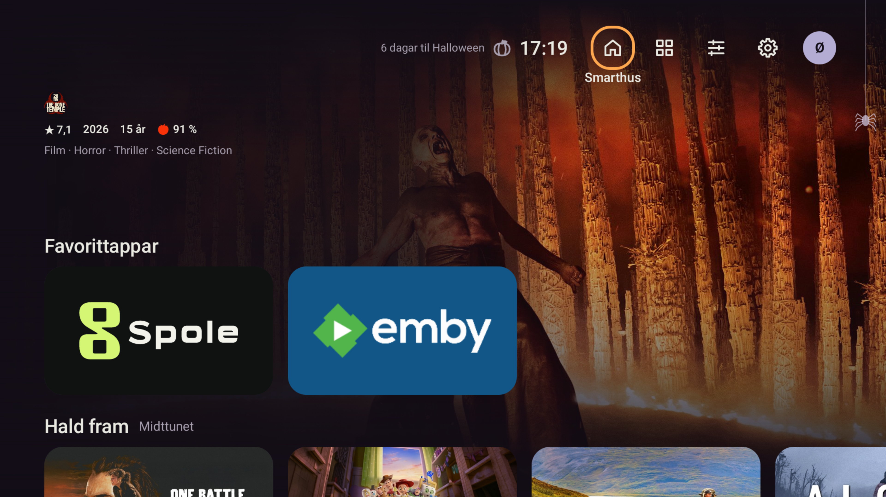
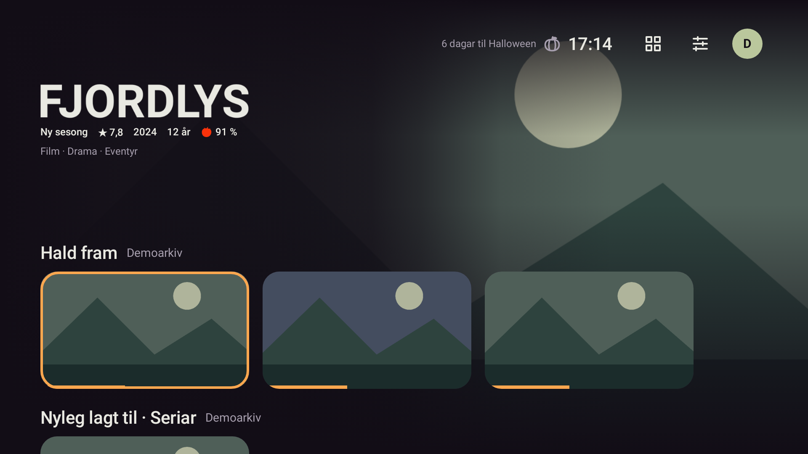

# Rein hero-metadata

2026-10-25: brukarbestilt vising utan rundingar rundt rating og andre fakta, «år» bak alder,
og scoreavhengig farge på tomatmarkeringa.

`RatingRow` viser no rein tekst utan bakgrunnar eller kantar. «Ny sesong» har òg mista si eiga
bakgrunn. Heroen bruker framleis den eksisterande scrimen over bibliotekbiletet.
Numerisk alder og norsk landkode blir lokaliserte (`12` → `12 år`, `NO-15` → `15 år`).
Andre sertifiseringar held originaltekst. Engelsk har korrekt eintal/fleirtal: `1 year`, `12 years`.

Kritikarscore følgjer [Rotten Tomatoes si grense](https://www.rottentomatoes.com/about):
raud tomat frå 60 %, grøn Rotten-markering under 60 %. Fargane ligg i `core/theme/RatingColors`
og blir ikkje bytte av profilaksent eller sesong. Ukjend eller ugyldig score blir framleis utelaten.

Før implementeringa feila oppdaterte alderstestar og prøva på Fresh/Rotten-semantikken.
Etter implementeringa: 87/87 relevante Heim-, media-UI-, design- og skjermtestar bestått,
0 hoppa over. Dette inkluderer direkte kontroll av teikna farge ved 59/60 %, gjennomsiktig
metadata, språk og stor skrift. Lint: 0 feil, 38 eksisterande åtvaringar og 1 hint. Debug-bygg OK.

Kommandoen brukte `scripts/gradle.ps1 testDebugUnitTest` med `--tests` for `app.stova.home.*`,
`app.stova.media.ui.*`, `app.stova.DesignRulesTest` og fire relevante `AppScreensTest`-metodar:
`homeWithHeroScoreAndMediaRows`, `mediaHeroAtDoubleFontSize`,
`dimmingChoicesChangeThePictureAndKeepTextReadable`, `appearanceOverviewHasTwoReadableLines`.
Same køyring hadde `-Pstova.screens=true lintDebug assembleDebug`.

Gjennomgåtte skjermfiler: `app/build/screens/09-home-media-hero.png`,
`11-home-media-font-2.png`, `appearance-contrast-light.png`, `appearance-contrast-medium.png`,
`appearance-contrast-dark.png` og `appearance-overview.png` (alle under `app/build/screens/`).
Lokale TDD- og byggloggar: `.superpowers/hero-metadata-*.log`.

Endeleg bygg vart installert med `-r` på emulator-5580 og Shield. Rein metadata vart kontrollert
med dei eksisterande bibliotekdataa. Profil- og kontofilene har identiske SHA-256 før og etter
denne bestillinga på begge einingane; ingen profilinnstillingar eller kontoar vart endra.

Endeleg APK: `app/build/outputs/apk/debug/app-debug.apk`.
SHA-256: `e41c73cc28e5be98758f976e09a3e7e4d9183f39e5dcfac3d2616f3d4df8e4b4`.
