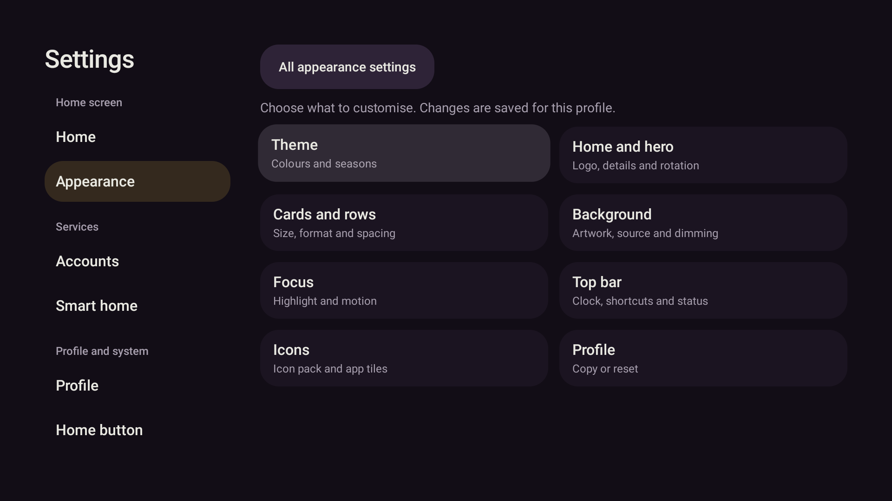
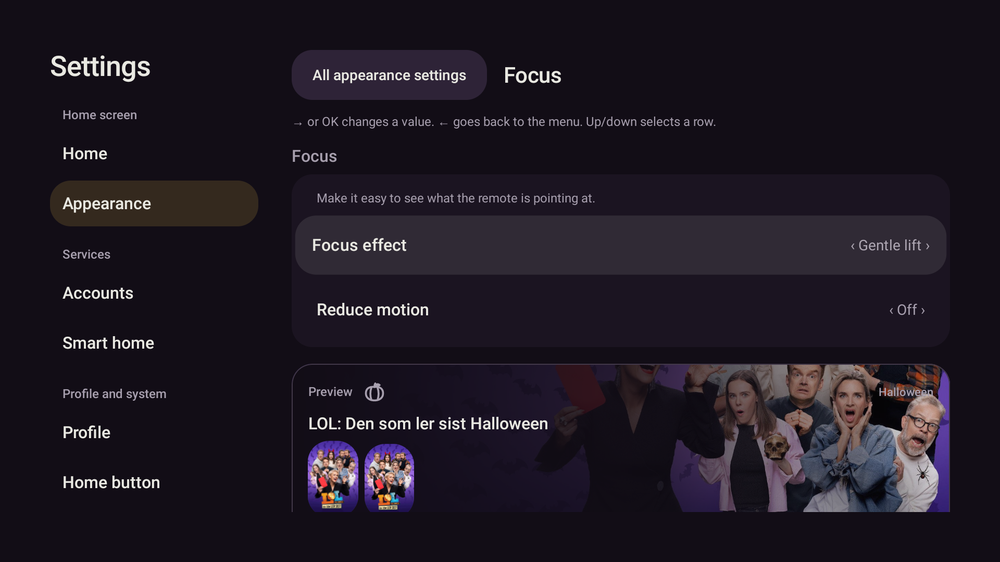

# Menysystem og mjuk rørsle – 25.10.2026

Bestillinga gjeld eit meir kompakt menysystem, mjukare overgangar og feil der
«Utsjånad på framsida» hoppar til Profil. Plan: `2026-10-25-menu-motion.md`.

## Funn og endringar

1. **Heim → Utsjånad:** Ein tastetest gjenskapte feilen. Det fokuserte lenkjeelementet
   vart fjerna før målflata var klar, og standardfokus på Profil valde feil seksjon.
   Fokus blir no parkert på den stabile målseksjonen først. Begge vegar og gjenteken
   OK er testa. Same prinsipp vernar radredigering av ein annan profil.
2. **Innstillingar:** Dei sju seksjonane er grupperte i Heimeskjerm, Tenester og
   Profil/system. Menyen er 200 dp brei med 44 dp minimumsrader som kan vekse med teksten.
   Utsjånad viser åtte kategoriar og berre vala for den opne kategorien. Stor skrift får
   éi kolonne. Tilbake gjenopprettar den same kategorien. Førehandsvisinga ligg etter vala.
3. **Langt OK:** Vanlege radhandlingar ligg fremst; overskrift, format og storleik
   blir opna under «Tilpass rada». Lukking gir fokus tilbake til dette valet.
4. **Rørsle:** Radpilene brukte `scrollToItem` før fokusering og hoppa dermed over
   animasjonen. Heim og Smarthus bruker no éin avbrytbar rullejobb med 560 ms easing.
   Rulleverdiane blir brukte i layout; inngangsalfa/forskyving blir lesne i lagfasen.
   Sideinngang er 340 ms, små overgangar 220 ms, fokus 160/240 ms. Dialogar skalerer frå
   0,985. Redusert rørsle gir null varigheit og omgåande rulling.

## Verifisering

- Raud før grøn: lenkje med OK, manglande kategorioversikt, lang kontekstmeny og
  apprad → medierad utan mellomrammer. Tastetest dekkjer òg reversering under rulling.
- 193 målretta testar med skjermprøver bestod etter inngangsovergangane.
- Native skjermfiler: `app/build/screens/menu-overview.png`, `menu-focus.png` og
  `menu-large-icons.png`. Dette er renderprøver, ikkje piksel-baseline-samanlikningar.
- Sluttkontroll: `pwsh -NoProfile -File scripts/gradle.ps1 testDebugUnitTest lintDebug assembleDebug '-Pstova.screens=true'`:
  **626/626 testar, 0 feil, 0 skip**. Lint: **0 feil**, 46 åtvaringar og 1 hint. Debug-APK bygd.
- Kodecommit `bd6bc49`. APK og installert fil på emulator-5580 har SHA-256
  `99aca2d90fc95d8931a38234c465247e1e1f49832470f1d16c3407bec78650b0`.
  Lokal APK-kopi: `.superpowers/menu-motion/stova-menu-motion-debug.apk`.
- Native D-pad med ekte data: Heim → Utsjånad → Fokus → Tilbake gjenopprettar Fokus;
  Kort og rader → Tilpass kvar rad går til Heim med fokus på utsjånadslenkja.
  Ingen av lenkjene går til Profil. Venstre/innstikk, radbyte begge vegar og reversering er prøvde.
- Appmenyen: åtte Ned når «Customise row», OK opnar berre radvala, Tilbake gir fokus til
  «Customise row», og neste Tilbake gir fokus til same app. Ingen val vart endra.
- Opptak `.superpowers/menu-motion/row-motion.mp4`: 12,04 s, 1280 × 720. Kontrollerte
  enkeltbilete viser apprada på mellomposisjonar før ho rullar ut; den blå appkunsten flyttar
  seg frå y=422 til 326 og 115 px. Dette dokumenterer mellomrammer, ikkje Shield-ytelse.
  Eit lengre navigasjonsopptak ligg i same mappe som `transitions.mp4` (34,97 s).
- `profiles.json`, `media-accounts.json` og `household.json` er byteidentiske før og etter
  installasjon/navigering (SHA-256 i `before-hashes.txt` og `after-hashes.txt`). Ingen app-kræsj
  vart observert, og ingen `Process: app.stova.debug` finst i den kontrollerte AndroidRuntime-loggen.

Førbilete ligg i `.superpowers/menu-motion/`. Berre emulator-5580 er brukt i denne
bestillinga. Ingen konto-/profilreset, tenestestyring, Shield-installasjon eller push.

