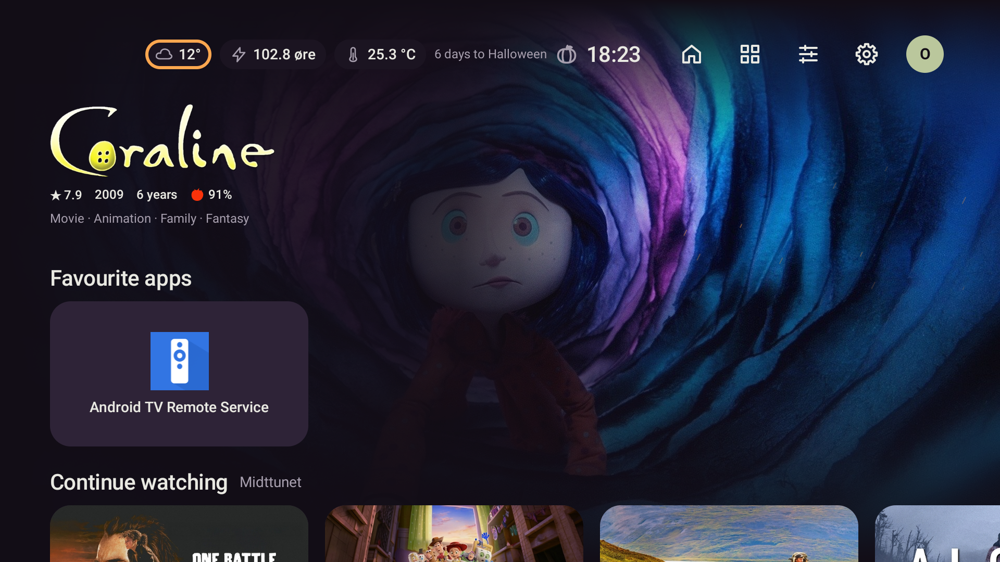
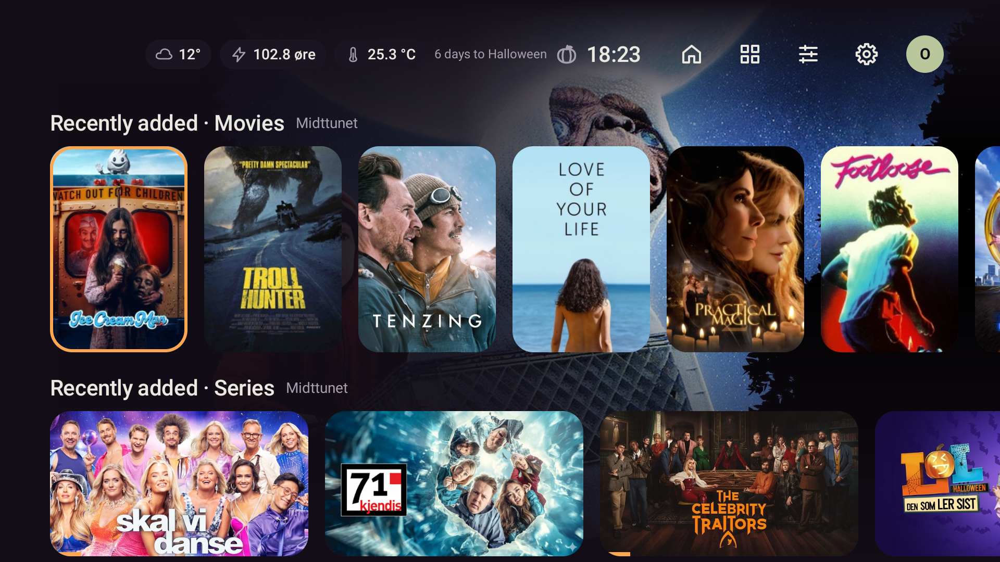
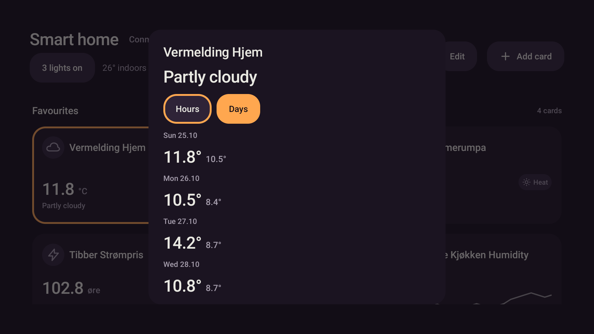

# Medierader: kortare venting etter feil

Verifisert 25.10.2026 på `emulator-5580` med eksisterande profil, Jellyfin-bibliotek og Home Assistant.

## Åtferd og testar

Ei feila henting brukte tidlegare same femminuttsfrist som ei vellukka henting. Neste retur til
Heim kunne difor halde fram med «Fråkopla», sjølv om serveren svarte igjen.
`MediaRepository` bruker no 30 sekund etter feil eller fråkopla rader. Vellukka henting går tilbake
til fem minutt. Eksplisitt oppdatering, ny konto/sesong og retur frå Spole kan framleis oppdatere tidlegare.
Avbroten henting set ikkje lenger tidspunktet som om forsøket var ferdig.

Tre nye testar vart først køyrde raude: dei venta to hentingar etter 31 sekund, men fekk éi.
Dei dekkjer nettfeil med snapshot, nettfeil utan snapshot og tidsavbrot. Ein fjerde test dekkjer
ein frisk konto saman med ein konto som feilar. Alle kontrollerer at 5 sekund ikkje gir ny henting,
31 sekund gir ny henting, og vellukka gjenoppretting gir femminuttsbufferen tilbake.

Sluttkontroll:

```powershell
pwsh -NoProfile -File scripts/gradle.ps1 testDebugUnitTest lintDebug assembleDebug '-Pstova.screens=true'
```

- **575 testar, 0 feil, 0 hoppa over**, inkludert skjermtestane. `MediaRepositoryTest`: 25/25.
- Lint: **0 feil**, 38 åtvaringar og 1 hint, same tal som før endringa.
- Debug-APK bygd og installert med `install -r`; SHA-256:
  `7483dd70641788e4496b7222e74326691a082d40bf3678d2eb0b31f6480773d2`.

## Emulator med ekte data

Kald start vart prøvd med `am force-stop` og `am start`. Snapshotet viste mellombels «Offline»
medan nettverket lasta. Ved siste kalde start viste kontrollen dette etter 11,6 sekund, og levande
Midttunet-rader utan «Offline» etter 16,1 sekund. Retur frå Innstillingar viste også levande rader.
Jellyfin sitt offentlege endepunkt svarte HTTP 200 både på verten og gjennom emulatoren.
Dei eksakte feil-/retry-intervalla er verifiserte med injisert klokke i testane; ingen feil vart
framprovosert ved å stoppe ekte tenester eller endre kontoar.

Profil- og kontofiler var byteidentiske før installasjon og etter heile gjennomgangen:

| Fil | SHA-256 før og etter |
|---|---|
| `profiles.json` | `231d4501addae02ac76ff0e9d39685b160d2f887dcd896c25ac57450a742a809` |
| `media-accounts.json` | `3c9f639a5604262c8747ac1d0ee0f40c65dc31b2d07b489756d7d4f4de485b1c` |

## Overgangar

Lokalt klipp: `.superpowers/offline-retry-transitions.mp4` (git-ignorert), 30,21 sekund,
H.264, 1280 × 720, om lag 3,3 MB. Opptaket er teke med Android `screenrecord` og har ikkje endra avspelingsfart.

Klippet viser Heim → D-pad ned i mediaradene → opp → Innstillingar (Heim, Utsjånad, Kontoar) →
Heim → Smarthus → vêrpanel med langt OK → Back → Heim. Ingen styringshandlingar vart utførte.
Stillbileta nedanfor er frå same gjennomgang i full emulatoroppløysing.







Ingen installasjon på Shield eller push i denne bestillinga, i samsvar med overleveringa.
