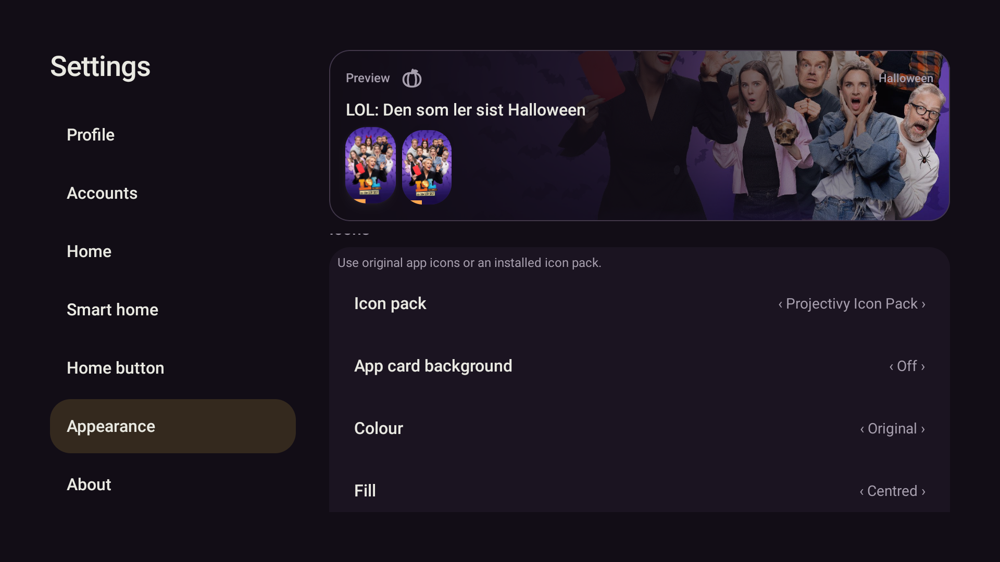
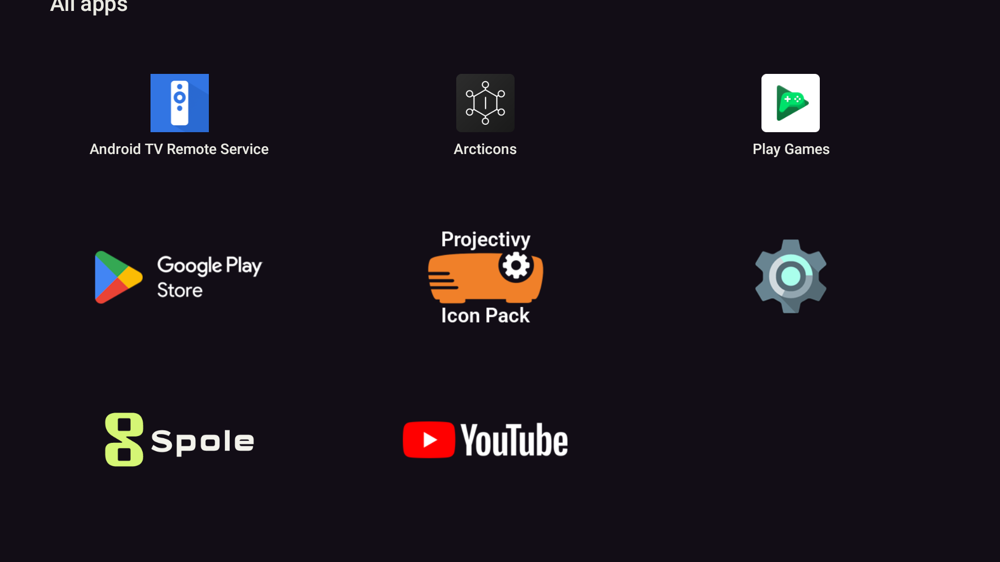
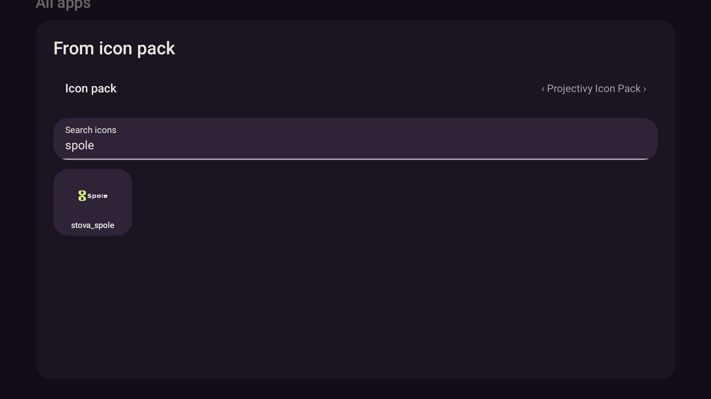

# Projectivy, originalt Spole-merke og transparente appkort

Verifisert 25.10.2026 på emulator-5580 med eksisterande profil, kontoar, appar og ekte mediedata.

## Leveransen

- Offisiell [Projectivy Icon Pack 1.1.9](https://github.com/SicMundus86/ProjectivyIconPack/releases/tag/1.1.9)
  er installert separat med `install -r`. Pakke: `dev.projectivy.blueprint.app`, versjonskode 119.
  SHA-256: `c3343564f6ff7a5ab51542a086f52820997fadbf26d947c1d30c3ef7bdad2d83`.
  APK-en ligg berre i git-ignorert `.superpowers/`, ikkje i Stova-repoet.
- Spole-supplementet bruker dei originale seks stiane og transformasjonane frå Spole sitt TV-banner.
  Berre bakgrunnen er fjerna. Endeleg utgåve har ingen nyteikna bokstavar eller endra merke.
  [SVG, PNG og kjeldeopplysningar](../icons/PROJECTIVY.md) følgjer repoet.
- Stova legg `stova_spole` til sin eigen Projectivy-katalog. Automatisk fallback fungerer for
  `app.reelstack` og `app.reelstack.debug`; same ressurs kan veljast manuelt. Originalpakken er urørt.
- Breie pakkeikon bevarer sideforholdet ved dekoding og får plass over kortbreidda.
  Tidlegare vart alle pakkeikon pressa til eit kvadrat.
- «Bakgrunn på appkort» er eit eige profilval. Val av Projectivy byrjar utan kortflate;
  brukaren kan slå flata på att. SVG/PNG har ekte alfatransparens.
- Søk og andre tekstfelt har fylt flate og nøytral understrek, med same D-pad-/OK-/tastaturkontrakt.
  Dei teiknar ikkje den gamle aksentramma. `SettingsNavRow` følgjer også standard rekkjefølgje for Modifier-parametrar.

## Verifisering

To raude regresjonar før implementasjon stadfesta kvadratisk dekoding og manglande transparent
Spole-wordmark. Native test for fokusert tekstfelt var òg raud (6 498 solide aksentpikslar) før
retting. Grøne testar dekkjer originalstiar i SVG/vektor, alfa, 16:9, begge Spole-pakkane, katalog og
manuelt ikonval, bakgrunn av/på, lagring og fargebevaring.

```powershell
pwsh -NoProfile -File scripts/gradle.ps1 testDebugUnitTest lintDebug assembleDebug '-Pstova.screens=true'
```

Sluttkontroll: **588/588 testar**, 0 feil, 0 hoppa over. Lint **0 feil**, 38 åtvaringar, 1 hint.
Debug-APK SHA-256: `1569035b96db6e5d7d4d8840233d874515418759c93c4c01013fde52205cf361`.
Endeleg APK er installert med `install -r` på emulator-5580.

Native skjermartefaktar er laga og inspiserte: `app/build/screens/spole-projectivy-transparent.png`,
`spole-projectivy-solid.png` og `focus-calm-{unfocused,focused,reduced-motion}.png` i same mappe.
Pikselprøver viser bakgrunnen gjennom den transparente flisa og kortflata når ho er slått på.

På ekte emulatorprofil er Projectivy vald og bakgrunn på appkort sett til Av. Katalogen frå APK-en
har **953 komponentmappingar og 899 ikon**; Stova legg til sitt eige Spole-supplement som ikon 900.
YouTube bruker pakka si automatiske mapping. Appar-visinga viser Spole og YouTube utan kortflate.
Langt trykk → Endre ikon → Frå ikonpakke → søk «spole» viser `stova_spole`.
Prøva vart avbroten med Back utan manuell overstyring eller endring av favorittane.

Alle tidlegare profilfelt bortsett frå dei bestilte vala `iconPack` og `appTileBackground` er uendra.
Kontofila er byteidentisk, SHA-256 `3c9f639a5604262c8747ac1d0ee0f40c65dc31b2d07b489756d7d4f4de485b1c`.
Ingen datatømming, HA-styring, Shield-installasjon eller push.






