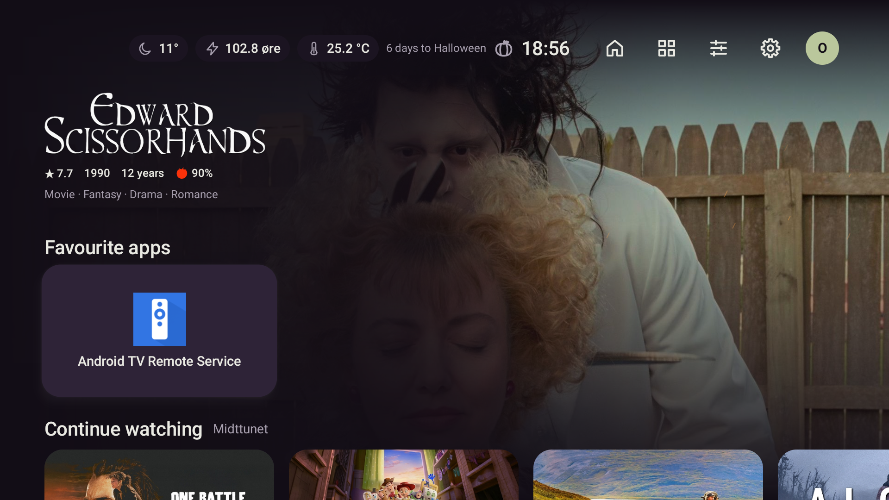
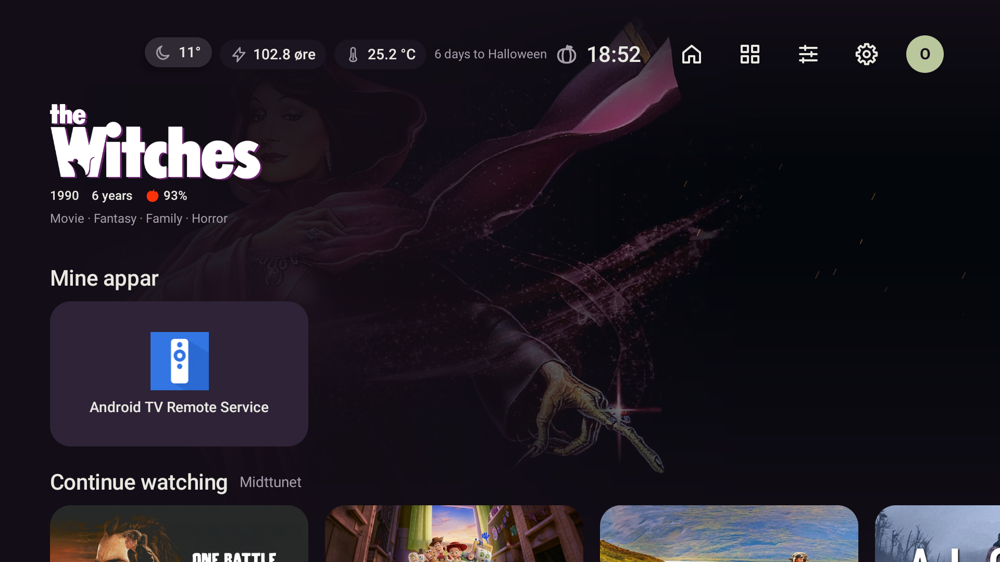
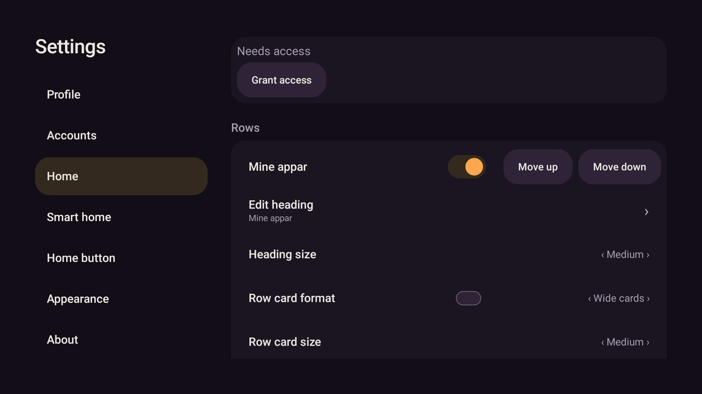

# Rolegare fokus og redigerbar framside

25.10.2026. Omfang avklart med eigaren: heile framsida – tekst, rader, storleikar, rekkjefølgje og vising.

Fokus er no svakt løft (2 dp), forstørring (2,5 % på kunst / 1,5 % på kontrollar) og svak
nøytral skugge. Kontrollar får 10 % lysare flate. Kunst og ikon bevarer fargane sine.
Ingen meny tvingar fram ring. Gamalt standardval `RING` blir vist som `LIFT`, utan å skrive om
profilen; `OUTLINE` og `RING_ZOOM` er uttrykkelege val. Redusert rørsle fjernar løft og skalering,
bevarer den stilleståande flate-/skuggeforskjellen og dempar nabokorta i aktiv rad.

Alle radoverskrifter kan endrast per profil/rad, frå langt OK-menyen eller Innstillingar → Heim.
Overskriftstorleik og vising av servernamn er eigne val. Tom tekst / Standardoverskrift tek tilbake
det omsette standardnamnet. Format, kortstorleik, rekkjefølgje og vising blir bevarte ved namneendring.
Heroen har separate brytarar for årstal, aldersgrense, vurderingar og Ny sesong. Innstillingar → Heim
lenkjer til dei globale vala for hero, kort, bakgrunn, fokus og toppfelt; radval er lenkja tilbake.

## Verifisering

To regresjonar vart køyrde raude før implementasjon: standardfokus løfta ikkje kort/menyval,
og Endre overskrift fanst ikkje. Sluttkontroll:

```powershell
pwsh -NoProfile -File scripts/gradle.ps1 testDebugUnitTest lintDebug assembleDebug '-Pstova.screens=true'
```

**583/583 testar**, 0 feil, 0 hoppa over. Lint 0 feil (38 åtvaringar, 1 hint). Debug-bygg OK.
APK SHA-256: `ab8e5e7904b3b27090e570355536f9b972abf119dbd080c0d412e2d2b608a7b2`.

Testane dekkjer lagra namn/storleik/kjeldevising, gamle JSON-profilar, kopiering til andre kontoar,
redigering/Avbryt/Standard, isolerte radnamn, framleis synleg fråkopla-status, hero-brytarane,
fokustransformasjonar, reduserte rørsler og uendra plassering av naboknappar.
Eksisterande ikonfargetestar bevarer pikselkrava. Ocean-rammetesten vel no `OUTLINE` uttrykkeleg.
Radmenytesten rullar til det nye nedste valet før han klikkar; lagringskrava er uendra.

Native skjermartefaktar er laga og inspiserte i `app/build/screens/`:
`focus-calm-unfocused.png`, `focus-calm-focused.png`, `focus-calm-reduced-motion.png`.
Dei kontrollerer synleg tilstandsendring og ingen solid aksentramme. Resten av skjermtestane,
inkludert eksisterande store-skrift-prøver, er med i fulltesten.

På emulator-5580 med ekte data: `install -r`, D-pad på framsida og menyane, endra Favorittappar
til Mine appar, lagra og returnert til Heim. Namnet overlevde ny installasjon/kald start og vart
sett tilbake til standard gjennom same editor. Tidlegare profilfelt er uendra etter prøva;
nye standardfelt er skrivne av JSON-lagringa. Kontofila er byteidentisk (SHA-256
`3c9f639a5604262c8747ac1d0ee0f40c65dc31b2d07b489756d7d4f4de485b1c`). Ingen HA-styring.







Ingen push eller Shield-installasjon i emulatorflyten. Fysisk fjernkontroll er ikkje prøvd i denne runden.
